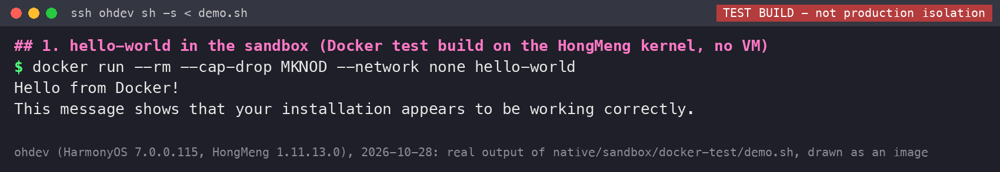
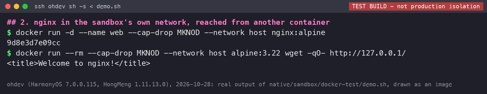
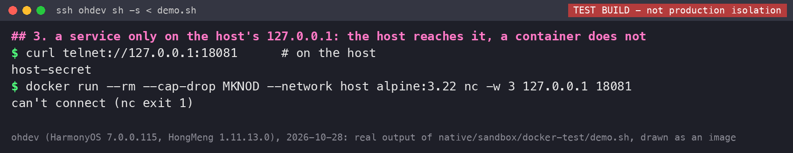
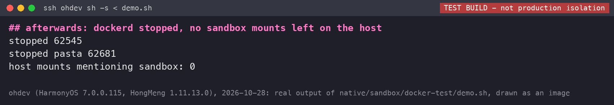

# 现场操作手册（草稿）

[English](demo-operator.md) | 中文

给在台上**亲手操作鸿蒙电脑**的人看的。照着做，演示就不容易翻车。
点击坐标、自动化脚本和彩排数据在 [demo.md](demo.md)（英文），这里只讲"手怎么动、眼睛看什么、嘴上说什么"。

> **草稿，还没在最终环境里完整彩排过。** 凡是标 **（待彩排确认）** 的地方，要在彩排时亲手走一遍再划掉。

## 先记住三条铁律

1. **同一时间只能开一台虚拟机。** 鸿融、OSEasy、Docker 后台虚拟机，三个里只能有一个在跑。第二台会被系统拒绝（401 "Not support vm multi-instance"）。所以每一段结束，**先把虚拟机关干净，再进下一段**。
2. **正常关机，别强制**：鸿融里的 Omarchy 盘装了增强服务，点鸿融卡片上的 **关机**（或在 Omarchy 里 **Super+Esc → Shutdown**）；OSEasy 里用 **Super+Esc → Shutdown**。不要在虚拟机里"重启"，不要"注销"。
3. **原生桌面的窗口别关**，最小化就行。关掉"Omarchy (native)" 后再点图标，桌面约 6 秒会自己重新起来，但里面开着的窗口都没了。

"Super" 键就是键盘上的 Windows 徽标键。**在原生桌面（第 1 部分）里，按 Super 快捷键请用 Alt+Shift 一起按来代替**：Windows 键会被鸿蒙拿去弹开始菜单，很多组合也被鸿蒙占用；app 会把同时按住的 Alt+Shift 当成 Super 发给 Omarchy。所以 Super+Return 就是 Alt+Shift+Return。快捷键里本来还带 Shift 的，**两个 Shift 都按住**：Super+Shift+B 就是 Alt+左 Shift+右 Shift+B。右 Alt 恢复成普通 Alt。虚拟机里（第 2、3 部分）照常用 Windows 键。

沙箱版 "Omarchy (sandbox)"（粉色图标，可选的第 4 段）打开就是全屏：Alt+Tab 切到别的窗口，Ctrl+Alt+Escape 最小化；在它的程序坞图标菜单里点"关闭窗口"关掉 app，Linux 随之停止；同一菜单里的 "Reset Linux" 会先确认，再把 Linux 恢复到刚安装时的样子。

## 演示顺序（约 10 分钟）

| # | 内容 | 时间（彩排实测） | 结束时必须做到 |
|---|---|---|---|
| 1 | D 原生桌面 + I Docker | 约 80 秒 + Docker 约 20 秒 | Docker 后台虚拟机已经停（见 1.9） |
| 2 | C 鸿融（换进去的 Omarchy 盘，和 B 同一份镜像） | 约 3 分钟 | 鸿融卡片显示"已关机" |
| 3 | B OSEasy | 约 2 分钟（清盘重装约 1.5 分钟到设密码屏 + 设密码/演示） | 虚拟机已关机（演示结束，可以不急） |

---

## 0. 演示前 1 分钟检查

能用眼睛看的都用眼睛看。要敲命令的标了 **【后台】**：由台下的助手在自己的电脑上（`ssh ohdev`）做，Yao 不用碰。

| # | 检查项 | 怎么确认 |
|---|---|---|
| 1 | 电源插着 | 右下角电池图标有充电标志 |
| 2 | 亮度调高、屏幕不会自动熄灭 | 设置里把自动熄屏改长或"永不"（具体菜单位置待彩排确认） |
| 3 | 免打扰打开 | 控制中心里有"免打扰"就打开（鸿蒙电脑上的具体开关位置待彩排确认） |
| 4 | 没有其他人/程序在操作这台电脑 | 【后台】通知所有远程会话、自动化脚本停手，演示期间谁也不要 ssh 去点屏幕 |
| 5 | **没有任何虚拟机在跑** | 鸿融卡片显示"已关机"、"开机"能点（Omarchy 盘装了增强服务，卡片状态可信）。OSEasy 也没在跑。【后台】最终确认：`ssh ohdev pidof stratovirt` 什么都不输出 |
| 5b | **鸿融不会自己开机** | 鸿融"虚拟机 → 功能设置 → 启动与闲置"里"启动客户端后虚拟机自动运行"和"闲置自动暂停虚拟机"都是关的（2026-10-26 已关；开着时一打开鸿融虚拟机就自己开机，会占掉第 1 段 Docker 要用的 HMV）。开场前不要点 dock 上的鸿融。【后台】`ssh ohdev pidof stratovirt` 有输出，并且 `ps -ef \| grep stratovirt` 里是 com.huawei.medivh 的，就从鸿融界面关掉它：Omarchy 盘装了增强服务，用"关机"；主盘没装，用"更多 → 强制关机"。关完再确认 `pidof stratovirt` 为空 |
| 6 | 原生桌面已经在后台跑起来 | 开机就自动启动，不用管（2026-10-26 真重启验证过：开机约 50 秒后桌面已在后台，登录后双击图标直接出桌面）。【后台】`ssh ohdev sh /data/local/archtest/bin/omarchy desktop status`；没在跑就 `... omarchy desktop start`（约 3 秒） |
| 7 | 桌面干净 | 只留鸿蒙自己的桌面；鸿融、OSEasy、"Omarchy (native)" 都没开着窗口；清掉通知 |
| 8 | 三个图标都找得到 | 鸿融（橙黄色）和 "Omarchy (native)" 在桌面左上；鸿融没开时 Dock 上**没有**它（2026-10-27 彩排），从桌面图标双击打开 |
| 9 | 鸿融关了自动更新 | 应用市场曾经自己把鸿融换了版本。现在应是 1.1.1.103 |
| 10 | OSEasy 处在可以安装的状态 | 打开 OSEasy，两种情况都正常：①画面中间盖着上一次留下的"**安装失败**"对话框（取消 / 再次安装）——点橙色"**再次安装**"开始装；**绝对不要点"取消"——取消会删掉虚拟机**。②若虚拟机被删过，显示"**立即创建**"——点它 →（弹"检测到…ISO"选**取消**）→"点击选择 ISO"→选 `oseasy-probe.iso`→打开 →"下一步"→"继续安装"→"仍要安装"→配置页（6核/8G/256G 默认）"开始安装"。两种都约 1.5 分钟到设密码屏。彩排前确认能走到"安装中"即可，别真的装到底 |
| 11 | OSEasy 的试用还没过期 | OSEasy 每台设备只能试用一次（**待彩排确认**：看一下 app 里有没有到期提示） |
| 12 | 鸿融里已经换成 Omarchy 盘、密码已设好 | 见下面"第 2 段演示前准备"。开机不用输密码（自动登录）；密码只在 sudo 和锁屏时用，Yao 记在脑子里，不写进任何文件，包括本手册 |
| 13 | 备用视频/截图已打开在另一台电脑上 | 见文末"备用方案" |

---

## 第 1 段：D 原生桌面 + I Docker（约 2 分钟）

| # | 手上做什么 | 屏幕上应该出现什么 | 等多久 | 嘴上说什么 |
|---|---|---|---|---|
| 1.1 | 在鸿蒙桌面上**双击** **"Omarchy (native)"** 图标（app 没开时 Dock 里没有它） | 先是一个写着"在等什么"的窗口，然后出现 Omarchy 壁纸和顶栏 | 约 10 秒 | "这不是虚拟机。Arch Linux 的程序直接跑在鸿蒙内核上，桌面画在一个普通的鸿蒙 app 窗口里。" |
| 1.2 | 点窗口标题栏上的**最大化** | 桌面铺满屏幕 | 1 秒 | |
| 1.3 | **Super+Return**（Alt+Shift+Return），输入 `fastfetch` 回车 | 一个终端，fastfetch 显示 Arch Linux ARM、HongMeng 内核、Hyprland | 10 秒 | "看内核那一行：HongMeng，鸿蒙自己的内核。程序是 Arch 官方仓库里原样的二进制。"（GPU 那一行写的是 llvmpipe：那是终端自己用 CPU 画字，整个桌面的合成走的是 GPU） |
| 1.4 | **Super+2**，再 **Super+1**（Alt+Shift+2、Alt+Shift+1），来回几次 | 工作区左右滑动，很顺 | 10 秒 | "这是 120Hz，用马良 GPU 画的，实测 110～119 帧。" |
| 1.5 | **Super+Shift+B**（Alt+两个 Shift+B） | Firefox 在终端旁边打开（新窗口，不会再出"恢复会话"页）。可以打开 omarchy.org。第一次可能弹一个小提示，点 "Okay, Got It" | 15 秒 | "浏览器是 Firefox，带沙箱。" |
| 1.6 | **Super+Space**（Alt+Shift+Space）弹出 Omarchy 菜单，看一眼，按 **Esc** | Omarchy 菜单出现又关掉 | 5 秒 | "这就是 Omarchy 原汁原味的菜单。" |
| 1.7 | **Super+Shift+F**（Alt+两个 Shift+F） | 文件管理器（Nautilus）打开主目录 | 5 秒 | |
| 1.8 | 点回终端，输入 `docker run --rm hello-world` 回车 | 先停一会儿（后台虚拟机在启动），然后出现 **"Hello from Docker!"** | **第一次约 27 秒**（2026-10-27 实测），别慌 | "鸿蒙内核跑不了容器，所以 Docker 自动借了一台很小的后台虚拟机，用的时候才开，用完四十秒左右自己关。我没敲任何 root 命令。" |
| 1.9 | **不用管**，Docker 虚拟机会自己关 | 没有可见变化 | 约 40 秒，讲 1.8 的说辞时就过去了 | "用完它自己就关了，下一段的虚拟机马上能开。" |
| 1.10 | 把"Omarchy (native)" **最小化**（不要关） | 回到鸿蒙桌面 | 2 秒 | |

**1.9 Docker 虚拟机自己关**（2026-10-27 彩排：hello-world 冷启动 27 秒，跑完后什么都不碰，约 40 秒 `pidof stratovirt` 为空）：没有容器在跑、也没有 docker 连着，就在 30 秒后自动关机。**这期间别再敲 `docker` 命令**，每敲一次都会重新计时。万一没关，见下面故障表最后一行。

说明：2026-10-26 在 ohdev 上彩排过（按键经鸿蒙的输入服务注入，右 Alt 当 Super）：1.1–1.7 全部和表里一样，双击图标后约 10 秒出桌面。第 1 部分里所有的 "Super" 都按 **Alt+Shift**（Super+Shift 就是 Alt 加两个 Shift）；按 Windows 键会弹出鸿蒙的开始菜单（点回桌面就关掉）。（那次彩排用的是右 Alt 当 Super，2026-10-27 起改成 Alt+Shift，还没彩排过。）ohdev 上装的 display app 是 main 48eee76（2026-10-27 装，含 Docker 被挡时的鸿蒙通知；装后双击图标出桌面正常）。

### 第 1 段：出了状况怎么办

| 现象 | 怎么办 |
|---|---|
| 点了图标，窗口一直写着"在等…"，桌面不出来 | 原生桌面没在后台跑（开机自启没生效；正常不会发生，刚开机不到 1 分钟时可能还没起来）。【后台】`omarchy desktop start`，等 10 秒。还不行：关掉 app 窗口，【后台】`omarchy desktop stop; omarchy desktop start`，再点图标。台上说一句"我们换个顺序"，直接跳到第 2 段鸿融 |
| 不小心把"Omarchy (native)" 关了 | 再双击一次图标：桌面会自己重新启动，约 6 秒（2026-10-26 彩排过，不用任何后台命令）。之前开着的窗口会没了，重新打开就行（Super = Alt+Shift） |
| 按 Super+Return 等快捷键没反应，或者弹出鸿蒙开始菜单 | 用 **Alt+Shift** 代替 Windows 键（Super+Shift 就是 Alt 加两个 Shift）。先用鼠标点一下 Omarchy 窗口里面，让它拿到焦点再按。还不行：跳过快捷键，只展示已经打开的东西 |
| Firefox 打开的是 "Sorry. We're having trouble getting your pages back."（恢复会话页） | 点 **Start New Session**，再打开 omarchy.org。（桌面重启时 Firefox 被杀会导致这一页；2026-10-27 已修，重开 app 后打开的是新标签页，正常不会再出现） |
| 某个窗口卡住不动 | 用 **Super+W** 关掉这个窗口，继续下一步 |
| `docker` 停了 30 秒左右没输出 | 正常，第一次要开后台虚拟机。边等边讲 |
| `docker` 报：`后台 Docker 虚拟机启动不了：鸿融或者 OSEasy 的虚拟机正在运行，请先关掉它` | 有别的虚拟机在跑（违反了检查项 5）。同时鸿蒙通知中心会收到一条 Omarchy (native) 的通知（app 在前台时没有横幅，只有铃铛红点；检查项 7 清通知时一并清掉）。台上：说"这正是一次只能跑一台虚拟机的限制"，跳过 Docker。【后台】看是哪台；进下一段鸿融前要先关掉它 |
| `docker` 超过 1 分钟还没输出 | 按 Ctrl+C，跳过 Docker，放备用截图（`docs/img/autostart/03-docker-cold.jpeg`）。【后台】`ohmarchy-vm stop`，确认 `pidof stratovirt` 为空再进第 2 段 |
| hello-world 之后过了 1 分钟，鸿融开机提示有别的虚拟机在跑 | Docker 虚拟机还没关（比如中间又敲过 `docker`）。在终端敲 `docker-vm stop`（约 6 秒，提示"Docker 虚拟机已关闭"）；如果它说还有容器在跑，先 `docker ps`、`docker stop <名字>`。或者【后台】`ohmarchy-vm stop` |

---

## 第 2 段：C 鸿融（约 3 分钟）

鸿融里跑的是换进去的 Omarchy 盘，和第 3 段 OSEasy 装的是**同一份公开镜像**。它装了鸿融的增强服务，所以开机直接进桌面，卡片会显示"运行中"，鸿融自己的"关机"按钮能用。

### 演示前准备（【后台】，约 10 分钟，前一天做好即可）

鸿融只能有一台虚拟机，所以把 Yao 主虚拟机的盘先换下来。全程鸿融虚拟机要处于关机状态（`pidof stratovirt` 为空）。

1. **备份主盘**：把 `/data/service/el0/virt_service/100/vm_manager/<id>/com.huawei.medivh/img` 下的 `vm.qcow2`、`stratovirt-vars` 复制到备份目录，核对两份大小一致（36 GB 约 1 分半）。
2. **换盘**：`hrswap.sh use-dev <IMGDIR> /data/local/vmtest/omarchy-b-nopass-os1.qcow2`（盘由 `hongrong/pure/make-qcow2.sh` 从公开镜像做出，约 10 秒）。打开鸿融，磁盘显示"已使用 6 GB"就是换好了。
3. **设密码**：点 **开机**。约 45 秒后出现全屏的"请设置密码 / Set your password"。鸿融可能弹"增强服务"引导框（点 **知道了**），也可能只在右下角出提示条（2026-10-27 第二次准备时只有提示条）；先点一下虚拟机画面再输入。输入至少 8 位的密码两次（由 Yao 定，记在脑子里）。屏幕显示"密码已设置"，接着自动安装鸿融增强服务，提示"鸿融会重启一次虚拟机"，按回车。右下角的提示条随即消失。约 1 分钟后虚拟机重启回到 Omarchy 桌面，没有登录界面。
4. **确认并关机**：把鸿融拉到前面（`aa start -b com.huawei.medivh -a EntryAbility`），卡片显示 **运行中**（绿色），点 **关机**，20 秒内回到"已关机"。

2026-10-27 彩排实测：开机到设密码屏 45 秒；设完后重启进桌面、卡片"运行中"；鸿融"关机"20 秒内完成并自动回到虚拟机页（截图 k01–k09）。

### 演示步骤

开始前确认：Docker 虚拟机已经停（1.9）。

| # | 手上做什么 | 屏幕上应该出现什么 | 等多久 | 嘴上说什么 |
|---|---|---|---|---|
| 2.1 | **双击桌面左上的鸿融图标**（橙黄色；鸿融没开时 Dock 上没有它） | 虚拟机页：Linux，当前状态"已关机"，已使用 6 GB | 5 秒 | "鸿融是华为自己的 Linux 虚拟机 app，从应用市场就能装，不需要 root。" |
| 2.2 | 点 **开机** | 鸿融变成全屏的虚拟机窗口，直接进 Omarchy 桌面（壁纸、顶栏 1–5 工作区），**不用输密码**，也不会再弹"增强服务"引导框 | 约 1 分钟（2026-10-27 彩排网络卡顿，没测准）。**进了桌面就接着往下做**：空闲 150 秒出屏保、300 秒锁屏并关显示（彩排里停了约 8 分钟，屏幕全黑，按键后出锁屏，输密码回车才回到桌面） | "这块盘就是第 3 段 OSEasy 装的那份公开镜像，完整的 Arch + Omarchy。" |
| 2.3 | **Super+Return**，输入 `fastfetch` 回车 | 终端；第一行是 AI 助手的配置提示（公开镜像不带密钥，正常）。fastfetch 显示 KVM Virtual Machine (StratoVirt)、Virtio GPU、2160x1440 120 Hz（2026-10-27 修好 EDID 后）、Omarchy 4.0.6、Linux 7.2.12-1.1-aarch64-ARCH、Hyprland 0.56.2、793 个包（2026-10-27 彩排） | 20 秒 | "这里是虚拟机，虚拟化层是鸿蒙自带的 HMV，鸿融用的是华为的 StratoVirt。"（在这一步讲，下一个窗口会把终端挤到一半） |
| 2.4 | **Super+Shift+B**，等 Chromium 出来后按 **Ctrl+L**（或点地址栏），输入 `omarchy.org` 回车 | Chromium 在右边打开，页面加载出来；没有 "Restore pages?"。右上角两条 Omarchy 通知（Update System、Learn Keybindings）一直挂着，压住浏览器工具栏右端，不用管 | 30 秒 | "网络走鸿融自己的虚拟网桥。" |
| 2.5 | **Super+2**，再 **Super+1** | 空的工作区 2，再回到终端和浏览器 | 10 秒 | "虚拟机里其实按 120Hz 在画，但鸿融全屏显示只给 60Hz，这是鸿融那边的事。"（2026-10-27 新镜像在鸿融里实测 `hyprctl monitors`：2160x1440@119.98） |
| 2.6 | 把鸿融主界面拉到前面：Dock 露出来就点 Dock 上的鸿融；不行就【后台】`ssh ohdev aa start -b com.huawei.medivh -a EntryAbility` | 卡片：当前状态 **运行中**（绿色），"关机""暂停"能点 | 5 秒 | "我们的系统里装了鸿融的增强服务，鸿融认得它在运行。" |
| 2.7 | 点 **关机**（鸿融窗口每次打开位置可能不同，看准按钮） | 屏幕上滚过关机信息，然后自动回到虚拟机页，卡片显示"已关机" | 18 秒（2026-10-27 彩排） | "关机也是鸿融自己的按钮。" |
| 2.8 | 确认已关：卡片"已关机"、"开机"能点（【后台】`pidof stratovirt` 为空） | | 5 秒 | |

### 演示后（【后台】，约 2 分钟）

鸿融关机状态下换回 Yao 的主盘：`hrswap.sh restore-main <IMGDIR> <备份目录>`，核对换回后的 `vm.qcow2`、`stratovirt-vars` 和备份大小一致。

### 第 2 段：出了状况怎么办

| 现象 | 怎么办 |
|---|---|
| 鸿融全屏后，按 Home 键、从屏幕边缘滑，都退不出来 | 正常，已知现象。Dock 露出来的话点 Dock 上的鸿融图标；不行就【后台】`ssh ohdev aa start -b com.huawei.medivh -a EntryAbility` |
| 开机后出现"请设置密码"或"增强服务"引导框 | 演示前准备没做完（第 3 步）。现场照着输两次密码，回车，等它重启一次再继续 |
| 空闲一会儿后黑屏或出现锁屏 | Omarchy 默认空闲 150 秒屏保、300 秒锁屏并关显示。按一下键盘（Shift）出锁屏框，输入密码回车。彩排里遇到过，这样恢复正常 |
| 卡片一直写"已关机"、"关机"是灰的，但预览是活的 | 增强服务没连上。点预览回到虚拟机，在里面 Super+Esc → Shutdown 关机 |
| 点"开机"被拒绝 / 没反应 | 多半是另一台虚拟机（Docker 后台虚拟机或 OSEasy）还没停。【后台】`pidof stratovirt` 看一下，`ohmarchy-vm stop` 关掉 Docker 虚拟机，再点开机。鸿融被拒时屏幕上具体怎么显示，**待彩排确认** |
| 按键没反应，或者字打到别的地方去了 | 按键是发给最前面那个窗口的。先点一下鸿融的虚拟机画面，再重输 |
| 虚拟机卡死，"关机"和 Super+Esc 都没反应 | 更多 → **强制关机**（最后手段） |
| 开机超过 3 分钟还没出桌面 | 更多 → 强制关机，跳到第 3 段，放备用截图（`docs/img/hongrong-omarchy-fastfetch.jpg`） |
| **千万别做** | 在虚拟机里"重启"（偶尔会卡死，要关机再开）；"注销"；在鸿融里点"删除" |

---

## 第 3 段：B OSEasy（约 3 分钟）

开始前确认：鸿融虚拟机已经关好（2.9）。

> **关键事实（2026-10-27 彩排实测）**：OSEasy 对 Linux 客户机只有一个"再次安装"按钮，点它会**先清空磁盘再从 ISO 重装**——所以每次演示都是一套干净的系统，**从点"再次安装"到设密码屏约 1.5 分钟**（实测：清盘+dd 约 50 秒，自动重启+扩盘约 15 秒），**没有"从已装好的硬盘 10 秒启动"这回事**。首次开机会弹**设密码**的全屏终端。开场时 OSEasy 通常停在上一次的"安装失败"对话框上（见检查项 10），点"再次安装"即可清掉它并开始装。

| # | 手上做什么 | 屏幕上应该出现什么 | 等多久 | 嘴上说什么 |
|---|---|---|---|---|
| 3.1 | Dock 上点 **OSEasy**（或点它已开着的窗口） | OSEasy 窗口，中间盖着"**安装失败**"对话框（"虚拟机 Windows 11 安装失败，请重新尝试安装"），下面是"正在安装 Windows 11…" | 2 秒 | "OSEasy 是第三方的 Windows 虚拟机 app，本来只给 Windows 用，所以它按 Windows 的方式报了个'安装失败'——其实虚拟机是好的。" |
| 3.2 | 点对话框里橙色的 **再次安装**（**千万别点"取消"——会删掉虚拟机**） | 对话框消失，画面变成"安装 Windows 11…"转圈：**正常**，它以为装的是 Windows，别信它的进度和 13 分钟。它在后台清盘重装 Omarchy | 几秒 | "它界面上写的是 Windows 11，实际里面装的是 Omarchy。它把磁盘清掉从头装，所以每次都是全新系统。" |
| 3.3 | 等它自动装完、扩盘、自动重启（不用操作） | 进度走完后自动进 Omarchy，弹出一个**全屏终端**："请设置密码 / Set your password"。若前面盖着 OSEasy 的介绍轮播，点 **收起介绍** | **约 1.5 分钟**（实测点再次安装到设密码屏约 88 秒） | "整个安装、首次扩满磁盘、自动重启都是全自动，不用敲命令。显卡是我们自己改的 Linux 驱动，让 Linux 用上了 OSEasy 给 Windows 准备的 3D 加速。" |
| 3.4 | 在设密码终端里输一个**至少 8 位**的密码（输两次，不显示字符），回车，再按回车关闭 | 绿字"密码已设置 / Password set"，自动登录进 Hyprland 桌面（Omarchy 壁纸 + 顶栏） | 约 15 秒 | "第一次进系统设一个管理员密码，以后 sudo 用它；设完照常自动登录。" |
| 3.5 | **Super+Return** 开终端，输入 `es2gears_wayland` 回车 | 蓝、红、绿三个转动的齿轮，终端里打印帧率 | 5 秒 | "虚拟机里每秒画 120 帧（实测 112～120 FPS），屏幕上 60 帧，因为 OSEasy 不向系统要高刷新率。" |
| 3.6 | **Super+2**、**Super+1** 来回几次 | 切到空工作区再切回齿轮，切换顺滑 | 10 秒 | "带着 GPU 负载连续跑了 4 个多小时没出错。" |
| 3.7 | 回到齿轮窗口，在终端里按 **Ctrl+C** 停掉 es2gears | 齿轮停 | 2 秒 | |
| 3.8 | **Super+Shift+B** 开浏览器 | Chromium 打开，显示 Google 新标签页 | 约 10 秒（冷启动） | "浏览器也在虚拟机里跑。" |
| 3.9 | 关机：**Super+Esc → Shutdown**（或在终端 `sudo systemctl poweroff`，密码就是刚设的） | 虚拟机关掉；OSEasy 回到界面，又弹出"安装失败"对话框（正常，见检查项 10） | 约 20 秒（实测约 19 秒 stratovirt 退出） | |

**OSEasy 关机后千万别点"取消"**：在"安装失败""安装过程出现异常"那类对话框里，**"取消"会删掉这台虚拟机**，下次就得从 ISO 重新装。要继续就只点 **"确定"** 或 **"再次安装"**，或者什么都不点直接关掉 OSEasy 窗口。

想**保留数据**（比如演示里装了东西想留着）：在 Omarchy 桌面里**重启**（Super+Esc → Restart），GRUB 会直接进已装好的系统、数据都在；一旦**关机**，OSEasy 就只剩"再次安装"（清盘重装）。所以留数据靠重启，别靠关机。

### 第 3 段：出了状况怎么办

| 现象 | 怎么办 |
|---|---|
| 提示"检测到有其它虚拟机正在运行"，开不了机 | 先想：鸿融真的关好了吗？Docker 虚拟机呢？【后台】`pidof stratovirt`，有就关掉再试一次。**如果确实什么都没在跑还被拒**，这是已知的、还没查清的问题（明明没有虚拟机进程，系统却说有）。台上：**跳过 B**，说"OSEasy 这边有个已知问题还在查"，放备用视频，直接收尾 |
| OSEasy 弹"安装过程出现异常，可能是 ISO 镜像的 install.wim 损坏或安装过程被人为取消" | **正常**，OSEasy 按 Windows 的方式误报（我们不是 Windows，没有 install.wim），虚拟机本身是好的。点 **"确定"** 关掉即可。**绝对不要点"取消"——"取消"会删掉这台虚拟机。** |
| 一直显示"正在安装 Windows 11…" / 进度条不动 | 正常，OSEasy 收不到 Linux 的"装好了"信号，外层会一直显示安装中。**看虚拟机控制台画面本身**，出现设密码终端或桌面就是好了 |
| 介绍轮播挡着画面 | 点"收起介绍" |
| 装了 3 分钟还没出设密码终端或桌面 | 把 OSEasy 控制台窗口点到最前面看一眼。还没有就跳过 B，放备用视频 |
| 屏幕一片黑 / 像屏保 | 空闲久了会进屏保、关屏（Omarchy 默认）。动一下鼠标或按任意键就回来，别以为是坏了 |
| 键盘按了没反应 | 先点一下虚拟机画面让它拿到焦点 |
| 某个窗口卡住 | Super+W 关掉它，继续 |

---

## 第 4 段（可选）：原生沙箱（约 3 分钟）

"Omarchy (sandbox)"（粉色图标）是原生路线的新方案：同样是 Arch 直接跑在鸿蒙内核上，不是虚拟机，但 Linux 被关在自己的目录和网络里，像一个普通 app 一样打开、关闭、重置。它和第 1 段的 "Omarchy (native)" 完全分开：各自的目录、镜像和 socket，两个可以同时开着。

**口径：** 这是测试机级别的隔离，不能当作对外的安全承诺。原因有三：抽象 Unix socket 仍然和主机共享（handover 3(a) 第 15 条），SELinux 域还是宽松的 `su`，Docker 也还没有接进来。台上不要说"安全""隔离得很彻底"，说"关在自己的目录和网络里"。

### 演示前检查（【后台】，前一天或开场前 5 分钟）

| # | 检查项 | 怎么确认 |
|---|---|---|
| 4a | 小助手在跑 | `ssh ohdev sh /data/local/ohm-sandbox/bin/ohm-sandbox serve`：输出 "serving …" 就是在跑，没在跑会自己起来。**开机自启还没在真重启后验证过**：机器重启过就一定要先跑这一条 |
| 4b | 沙箱是停着的，演示用的包没装 | `ssh ohdev sh /data/local/ohm-sandbox/bin/ohm-sandbox status` 显示 stopped。上次演示装过包就先重置一次（`... ohm-sandbox reset`，约 35 秒） |
| 4c | 空间够重置 | `ssh ohdev df -h /data`：可用要 50 GB 以上（2026-10-28 是 101 GB），不够重置会拒绝 |
| 4d | 网络通 | ohdev 连着 Wi-Fi。沙箱开机时会抄一份当时的默认路由；中途换了网络，【后台】`... ohm-sandbox net` |
| 4e | sudo 密码 | 终端里的用户是 builder，`sudo` 要密码：测试密码与鸿融演示盘相同，口头告知，不写进任何文件。重置快照里就是这个密码（2026-10-28 改好，sudo pacman 装包、重置后再 sudo 都验过） |

### 演示步骤

| # | 手上做什么 | 屏幕上应该出现什么 | 等多久 | 嘴上说什么 |
|---|---|---|---|---|
| 4.1 | 在鸿蒙桌面上**双击**粉色的 **"Omarchy (sandbox)"** | 直接全屏，先黑一下，然后出现粉色壁纸和顶栏 | 约 20 秒（2026-10-28 实测 16–19 秒） | "这个是新方案。双击就开，跟普通 app 一样；Linux 是这个时候才启动的。" |
| 4.2 | 不用操作 | 全屏桌面 | | "它一打开就是全屏。要回鸿蒙：Alt+Tab 切走，Ctrl+Alt+Esc 最小化。" |
| 4.3 | **Alt+Shift+Return** 开终端 | 一个终端 | 3 秒 | |
| 4.4 | 输入 `sudo pacman -S --noconfirm cowsay` 回车，输入测试密码（见 4e），装完输入 `cowsay hello` 回车 | 下载、安装，然后一头牛说 hello | 约 15 秒（待彩排确认） | "Arch 官方仓库，pacman 照常能用，里面是 root。" |
| 4.5 | 输入 `ls /storage /system` 回车 | 两行 `No such file or directory` | 2 秒 | "鸿蒙的照片、文件、系统目录，在它里面根本不存在。它只看得见自己的目录。" |
| 4.6 | 输入 `curl -m 3 http://127.0.0.1:22` 回车 | `Failed to connect …`（curl 退出码 7） | 3 秒 | "它有自己的网络，能上网（刚才 pacman 就是），但碰不到鸿蒙本机上的服务。" |
| 4.7 | **Ctrl+Alt+Esc** 最小化，在程序坞上**右键**粉色图标 → **"Reset Linux"** | 弹出确认框 "Reset Linux?"（Cancel / Reset）。Linux 在你点之前不会动 | 3 秒 | "装坏了也不怕：一键恢复到刚安装时的样子。先问一下，不会误点。" |
| 4.8 | 点 **Reset** | 黑屏一会儿，桌面重新出来 | 约 40 秒（重置约 33 秒 + 启动约 6 秒，2026-10-27 实测；彩排时再确认屏幕上的样子） | 边等边说："刚才装的东西全部清掉了。" |
| 4.9 | **Alt+Shift+Return**，输入 `cowsay hi` 回车 | `command not found` | 5 秒 | "回到原样了。" |
| 4.10 | 关掉 app（程序坞图标菜单 → **关闭窗口**） | 回到鸿蒙桌面 | 2 秒 | "关掉 app，Linux 就停了，不在后台占资源。" |

说明：2026-10-28 在 ohdev 上逐项验过（4.1、4.3、4.5、4.6、4.7 的确认框和 Cancel 在屏幕上验过；4.8 的重置 10-27 在屏幕上验过，cowsay 确实没了；4.4 的 pacman 联网在网络改造后从后台验过），**还没有按这张表完整彩排**。4.7 的右键菜单入口、4.8 黑屏的样子以要彩排时为准。

### 第 4 段：出了状况怎么办

| 现象 | 怎么办 |
|---|---|
| 双击后一直黑屏、没桌面 | 小助手没在跑（多半是机器重启过，见 4a）。关掉 app，【后台】`ohm-sandbox serve`，再双击。还不行就跳过第 4 段 |
| pacman 下载不动 | 网络问题。【后台】`ohm-sandbox net` 重连；不行就跳过 4.4，直接讲 4.5、4.6 |
| `sudo` 密码不对 | 密码和鸿融演示盘相同（4e）。还不对就跳过 4.4 和 4.9，只讲 4.5–4.8 |
| 重置超过 2 分钟桌面还没回来 | 关掉 app，【后台】`ohm-sandbox status` 看一下；跳过，收尾 |
| 第 1 段的 "Omarchy (native)" 受影响了吗 | 不会：两个完全分开，可以同时开（10-28 全程核对过 native 的会话和进程没变） |

### （可选·展示）沙箱里的 Docker（约 1 分钟，不进主流程）

Docker 测试版直接跑在鸿蒙内核上，不是虚拟机：dockerd 被关在自己的目录 `/data/local/ohm-docker-test` 和自己的网络里（细节见 native/sandbox/docker-test/README.md）。**它还没有接进粉色的沙箱 app**，所以不在沙箱终端里敲，而是由【后台】在助手电脑上运行一个脚本，把助手的终端投到屏幕上。时间不够就跳过，不影响别的段。

**口径：** "这是测试版，不是正式隔离。" 鸿蒙内核缺 devices cgroup、cgroup 资源限制和 seccomp，容器和容器之间、容器和内核之间的隔离都比 Linux 上的 Docker 弱（README 里每个开关都写了削弱了什么）。台上可以说"能跑容器、关在自己的目录和网络里"，**不要说**"安全""和 Linux 一样的隔离"。

**演示前检查（【后台】）：** 没有虚拟机在跑也行、在跑也行（它不是虚拟机）；`ssh ohdev du -sh /data/local/ohm-docker-test` 能返回（目录在，约 850 MB）；镜像已经在本地（alpine:3.22、nginx:alpine、hello-world），演示时不用下载。

| # | 【后台】做什么 | 屏幕上应该出现什么 | 等多久 | 嘴上说什么 |
|---|---|---|---|---|
| D.1 | 投屏助手的终端，运行 `ssh ohdev sh /data/local/ohm-docker-test/demo.sh` | 先停约 10 秒（起 dockerd），然后出现第 1 步：`Hello from Docker!` | 约 20 秒 | "Docker 直接跑在鸿蒙内核上，没有虚拟机。" |
| D.2 | 不用操作 | 第 2 步：起一个 nginx，另一个容器取到 `<title>Welcome to nginx!</title>` | 约 15 秒 | "容器里起一个网站，另一个容器能访问它。它们用的是沙箱自己的网络。" |
| D.3 | 不用操作 | 第 3 步：宿主上 `host-secret`；容器里 `can't connect (nc exit 1)` | 约 10 秒 | "鸿蒙本机上一个只对本机开放的服务，本机能连上，容器连不上。" |
| D.4 | 不用操作 | 最后三行：`stopped …`、`stopped pasta …`、`host mounts mentioning sandbox: 0` | 约 5 秒 | "用完就停，主机上不留挂载。还是那句：这是测试版。" |

脚本一次跑完约 1 分钟（10-28 在 ohdev 上连跑两遍，输出如下图，是真实输出渲染成的图，不是屏幕截图）：

出了状况：脚本 1 分钟没出第 1 步，或者报 `start failed`，就 Ctrl+C，【后台】`ssh ohdev sh /data/local/ohm-docker-test/stop.sh`，放上面四张图讲，跳过。

---

## 备用方案

原则：**任何一段卡住超过 30 秒（Docker 1 分钟、鸿融开机 3 分钟），就放弃这一段**，说一句"这里我们放一段录好的"，放备用视频，然后进下一段。下一段开始前依然要确认没有虚拟机在跑。

| 段 | 备用素材 | 状态 |
|---|---|---|
| D 原生 | 录屏：`<待录制：D 全程，约 80 秒>`；截图：`docs/img/autostart/02-app-open.jpeg` | 视频待录 |
| I Docker | 截图：`docs/img/autostart/03-docker-cold.jpeg` | 有 |
| C 鸿融 | 录屏：`<待录制：C2 全程>`；截图：`docs/img/hongrong-omarchy-fastfetch.jpg` | 视频待录 |
| B OSEasy | 录屏：`<待录制：B 再次安装 → 桌面 → es2gears>`；截图：`docs/img/oseasy-mb14-kmsgl-1.jpeg` | 视频待录 |

备用素材放在另一台电脑上（或 U 盘，鸿蒙电脑这边不要依赖它），事先打开好。

---

## 【后台】命令速查（给助手，不给 Yao）

都在助手自己的电脑上执行，`ohdev` 上是 root。

| 用途 | 命令 |
|---|---|
| 有没有虚拟机在跑（空 = 没有） | `ssh ohdev pidof stratovirt` |
| 关掉 Docker 后台虚拟机 | `ssh ohdev sh /data/local/kaidashi/bin/ohmarchy-vm stop` |
| 原生桌面状态 / 启动 / 重启 | `ssh ohdev sh /data/local/archtest/bin/omarchy desktop status`（`start`、`stop`） |
| 沙箱：小助手 / 状态 / 重置 / 重连网络 | `ssh ohdev sh /data/local/ohm-sandbox/bin/ohm-sandbox serve`（`status`、`reset`、`net`） |
| 打开原生桌面 app | `ssh ohdev aa start -a EntryAbility -b com.ohmarchy.display` |
| 把鸿融拉到前面（退出全屏用） | `ssh ohdev aa start -b com.huawei.medivh -a EntryAbility` |
| Docker 网关日志 | `ssh ohdev tail /data/local/kaidashi/ownvm/svc/gate.log` |
| 沙箱里的 Docker（测试版）：演示 / 停止 | `ssh ohdev sh /data/local/ohm-docker-test/demo.sh`（`stop.sh`） |

---

## 问答小抄

**Q：A 到 L 这么多路线是什么？为什么只演示 D、I、C、B？**
A：A 是鸿蒙自带 Linux 容器里的命令行工具，没有桌面；E 裸机没开始；F 只在 Mac 上的模拟器里、纯软件很慢；G 铠大师和 H 真机上的 Aetherium 确认走不通；J（把 Linux 程序签进 app，不要 root）现在只跑到 busybox；K 没开始；L 浏览器内核里跑 Linux 暂停了。能拿出来演示的就是 D、I、C、B。

**Q：可以归纳一下吗？**
A：两条线。**线一：在虚拟机 app 里即插即用**（B、C），不要 root，今天就能用，差的是 app 自己（60Hz、OSEasy 按 Windows 设计）。**线二：原生**（D + I），效果最好（120Hz、直接用 GPU、78 个 app 有 74 个 3 秒内打开），但要 root。

**Q：为什么虚拟机里只有 60Hz？**
A：鸿蒙只在某个窗口主动"要"120Hz 时才把屏幕调到 120Hz。鸿融和 OSEasy 都不要。虚拟机里其实在按 120Hz 画（鸿融里 119.98Hz，OSEasy 每秒 120 帧送到宿主），是 app 显示时只给 60Hz。原生桌面的 app 会主动要 120Hz，所以是 119 帧。

**Q：D 为什么要 root？**
A：要用 chroot 和挂载把 Arch 环境搭起来，还要一个 root 小程序把 GPU 连接转给 app。普通 app 不能运行没签进安装包的程序（XPM 代码完整性保护），也拿不到需要的内核功能。

**Q：鸿蒙要提供什么，才能不用 root 跑原生？**
A：四件事：
1. **允许 app 运行自带的 Linux 程序**（为这种情况放宽 XPM，或者给一种专门的签名/权限）；
2. **内核功能**：user namespace、cgroup v2、进程间共享 `CLONE_FS`（沙箱、容器、Chromium 沙箱都要）；
3. **开放虚拟机接口**（现在是写死的 8 个 app 白名单，Docker 后台虚拟机要用）；
4. **修 HMV 的 ID 寄存器问题**（新内核读不认识的 ID 寄存器会把 vCPU 卡死；我们写了报告给华为）。

有了前两项，D 就能不用 root、以现在的性能跑。

**Q：原生桌面上的 Docker 是怎么回事？**
A：鸿蒙内核没有容器需要的命名空间和 cgroup，所以 Docker 跑在一台我们自己起的、没有界面的小虚拟机里：root 直接在 `/dev/hmv`（鸿蒙的虚拟化层）上启动系统自带的 StratoVirt。**不是鸿融**，也**不是鸿蒙自带的融合开发引擎**（那个是容器，跑不了 Docker）。第一次敲 `docker` 时它自己开机（`hello-world` 约 27 秒出结果），用完约 40 秒自己关，个人目录共享进去，挂载目录照常能用。空闲时只占宿主约 1.2 GB 内存。

**Q：为什么一次只能开一台虚拟机？**
A：鸿蒙的虚拟化层系统级只允许一台，第二台直接被拒（401 "Not support vm multi-instance"）。所以演示是一段一段交接的。

**Q：鸿融怎么知道虚拟机在运行？**
A：鸿融要等虚拟机里它的"增强服务"报到才显示运行中。鸿融只给 UOS/麒麟提供这个服务的安装包；我们让它在 Arch 上也能装，第一次设密码时自动装上，所以卡片显示运行中，鸿融的关机按钮也能用。

**Q：普通用户能用上吗？**
A：线一（B、C）不要 root，对外发布正在准备：镜像放 GitHub Releases，加上写给普通用户的说明。

---

## 待彩排确认清单

1. ~~开机后原生桌面自动启动~~ 已确认（2026-10-26 真重启：开机 50 秒后桌面已在后台；正常登录后双击图标，第一张截图就是桌面；`pidof stratovirt` 为空；全程没用后台命令）。
2. ~~关掉 app 再点图标会自己把桌面重启好~~ 已确认（同一次重启后：关掉再双击，桌面回来）。
3. 原生桌面里的 Super 快捷键：Windows 键会被鸿蒙拦截（弹开始菜单），2026-10-27 起改成 Alt+Shift 当 Super（之前的右 Alt 方案注入按键验证过）；还差用实体键盘亲手按一遍。
4. 鸿蒙电脑上"免打扰""自动熄屏"的设置位置。
5. 鸿融在别的虚拟机（Docker）还在跑时点"开机"，屏幕上显示什么。
6. ~~鸿融关机后是否自动退出全屏回到虚拟机页~~ 已确认（2026-10-27）：点鸿融"关机"后自动回到虚拟机页，卡片显示"已关机"。
7. ~~OSEasy 新流程：点"再次安装"直接从装好的硬盘启动、约 10 秒进桌面~~ 已否定（2026-10-26/27 实测）：OSEasy 对 Linux 只有"再次安装"，它会**清盘重装**，约 2.5～3 分钟进桌面，没有 10 秒快启。要保留数据只能在桌面里重启（GRUB 链载已装好的系统），一旦关机就只剩清盘重装。
8. ~~OSEasy 里是否自动登录（不用输密码）~~ 已确认：首次开机弹设密码终端（≥8 位），设完后自动登录；之后开机也自动登录。
9. OSEasy 虚拟机里用手按键盘快捷键能用；Super+Shift+B 打开的是不是 Chromium。
10. ~~OSEasy 从里面关机后界面显示什么~~ 已知：关机后 OSEasy 可能弹"安装过程出现异常 / install.wim 损坏"误报（点"确定"，别点"取消"），然后回到只有"再次安装"的状态；再次安装是清盘重装。
11. OSEasy 试用是否还有效。
12. "检测到有其它虚拟机正在运行"误报的原因（已知未解决）；彩排时看看出现频率。
13. hello-world 跑完 1 分钟内 Docker 虚拟机确实已停（`pidof stratovirt` 为空）。
14. 备用视频录好并放到另一台电脑上。
