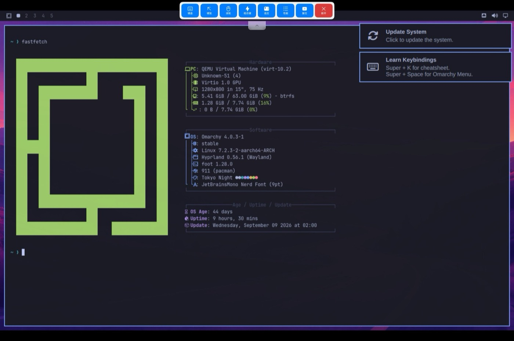

# Route E: Omarchy in Aetherium on the DevEco HarmonyOS PC emulator

No HarmonyOS hardware needed. DevEco Studio's emulator runs a HarmonyOS 7.0
"2in1" (PC) image on the development machine; inside it, the open-source
[Aetherium](https://github.com/AetheriumSimulator/qemu-hmos) app runs QEMU
in-process (TCG, no KVM) and boots the complete Omarchy AArch64 disk; the
guest's screen is shown in a HarmonyOS window by the HarmonyOS-native VNC
client [RemoteDesk](https://github.com/Mydstiny/RemoteDesktopHarmonyOS).

```
macOS (Apple Silicon)
└─ DevEco emulator: HarmonyOS 7.0.0.107, deviceType 2in1, 8 vCPU / 16 GB
   ├─ Aetherium (patched HAP): QEMU 10.1 TCG, virt + virtio-gpu-pci, VNC :5901
   │  └─ Omarchy 4.0.3 AArch64 (Arch kernel 7.2.3, Limine, systemd, SDDM, Hyprland)
   └─ RemoteDesk: VNC client → 127.0.0.1:5901, full-screen HarmonyOS window
```

## Status

Verified on a MacBook Pro (M3 Max, macOS 15.7), DevEco Studio 26.0.0.851,
emulator 26.0.0.402, image 7.0.0.107:

- The Omarchy disk boots through UEFI and Limine on Omarchy's own 7.2.3 kernel
  (no kernel swap, unlike route B).
- Firmware, Limine, the tty1 first-boot wizard, the setup screen and the
  desktop show on `virtio-gpu-pci`, in RemoteDesk's HarmonyOS window and over
  VNC on the host.
- The first-boot wizard completes (keys sent over VNC, so no HarmonyOS IME is
  involved).
- The Hyprland desktop runs: Omarchy 4.0.3, Hyprland 0.56.1 (Wayland) on
  llvmpipe, Quickshell bar, notifications, terminal, hyprlock, fastfetch;
  shown full-screen in RemoteDesk inside HarmonyOS (screenshot below).
- SDDM never gets there on its own: its Wayland greeter is killed about 21 s
  after it starts (`Auth: sddm-helper exited with 2`, then a new greeter), and
  under TCG the greeter's Hyprland plus the Qt greeter need longer. The session
  is started from a text console instead, see
  [Start the desktop](#start-the-desktop).
- Timing on the test machine: boot to the wizard about 5 minutes; Omarchy's
  first-boot setup about 50 minutes, most of it in `mkinitcpio` rebuilding the
  Limine UKI (gzip under TCG); the desktop about 2 minutes after `uwsm start`.
  Everything is software emulation inside an emulator, so it is a proof that
  the stack works, not a daily desktop.

Not available in the emulator: hardware virtualization (no `/dev/kvm`, no
hypervisor nodes, no `vm_manager` access), so routes B and C (Oseasy, 鸿融,
Linux engine) do not apply here; AppGallery apps are not installable either.



## Requirements

- DevEco Studio with its emulator (tested 26.0). Accept the emulator licenses
  yourself: `"$EMULATOR" -license`.
- Image download: the CLI only downloads emulator images when DevEco's
  country/region is the Chinese mainland, and the download needs a CN egress.
  The region check is local (`options/country.region.xml`, read before any
  request); `10-create-emulator.sh` stops with the file to change. A proxy can be
  passed for the download only with `EMU_HTTP_PROXY=http://127.0.0.1:PORT`.
- `hdc` (DevEco's `sdk/default/openharmony/toolchains/hdc` or any recent one),
  `gh`, `python3`, `unzip`, `shasum`. About 15 GB free.
- If a phone or other device is attached over USB, `hdc` sees it too; all
  scripts here only talk to `127.0.0.1:*` targets.

## Build and install

```sh
emulator/10-create-emulator.sh   # 2in1 image (2.7 GB), instance ohm2in1 (8 vCPU, 16 GB, 64 GB), boot
emulator/20-fetch-inputs.sh      # Aetherium test HAP -> patched HAP, Omarchy qcow2 (3.4 GB), RemoteDesk
emulator/30-install.sh           # install both HAPs, copy the qcow2 to 下载, forward VNC/serial ports
```

Settings live in `emulator/config.sh`; outputs go to `work/emulator/`. The
emulator installs unsigned HAPs; a real device would need them signed with your
own certificate and profile.

### What the Aetherium patch does

`emulator/lib/patch_aetherium.py` only accepts the pinned release
(`test-14456eb6…`) and checks every original byte and the output hashes:

| Problem | Symptom | Patch |
|---|---|---|
| `-tpmdev emulator,id=tpm0` is always passed for `virt`, but this build's QEMU lacks the built-in TPM patch | `qemu_init` exits: `tpm-emulator: parameter 'chardev' is missing` | the inline-built `"-tpmdev"` (two `mov`/`movk` immediates) becomes `"-L"`, so `emulator,id=tpm0` is just an extra firmware search path |
| The display choice `virtio-gpu-pci` is mapped to `virtio-gpu-device` (MMIO) on aarch64; `virt`'s virtio-mmio is legacy, which virtio-gpu rejects | VNC shows `Display output is not active`; in the guest the GPU's virtio status is `0x83` (FAILED) and there is no `card0` | the `-device tpm-tis-device,tpmdev=tpm0` string becomes `-device virtio-gpu-pci`: modern virtio, UEFI GOP, VNC console 0 |
| `edk2-aarch64-code.fd` is 2 MiB, QEMU 10 `virt` needs a 64 MiB pflash | `cfi.pflash01 device … requires 67108864 bytes, pflash0 block backend provides 2097152 bytes` | pad to 64 MiB |

The firmware is copied into the app sandbox only once; after installing a new
firmware, clear the app data (`hdc shell bm clean -n com.caidingding233.qemuhmos -d`).

## Create the VM

Aetherium's UI, in the emulator window (maximize it first). Two app bugs shape
the order:

- After a data reset, importing a disk fails with "导入磁盘镜像失败: No such file
  or directory": the import creates `files/vms/NAME` but not `files/vms`.
  Anything that runs `StoragePaths.ensureDirectories()` first fixes it, e.g.
  picking an ISO in a VM's settings.
- An ISO chosen in the creation wizard is never copied into the sandbox
  (install mode then stops with "install ISO 不可用"). Pick ISOs from
  虚拟机设置 → ISO 镜像 → 选择 instead, which copies immediately
  ("ISO 已复制到沙箱并挂载").

Steps:

1. Allow the two file permissions on first start.
2. 创建第一个虚拟机 → 高级设置 → aarch64 → `virt` → any display → `virtio-net-pci`
   → no sound → 8 GB → any disk size → Linux → no ISO → any name → 创建并启动 →
   取消 (the start-mode sheet). This throw-away VM exists only to create the
   directories: open its 虚拟机设置 → ISO 镜像 → 选择 and pick any file in 下载.
3. 添加列表 → the same choices, but on the disk page use 导入现有 QEMU 磁盘 → 选择 →
   下载 → `omarchy-aarch64-virt.qcow2`, and an ASCII name (non-ASCII names are
   reduced to `_`). 创建并启动 copies the 3.4 GB disk.
4. In the start-mode sheet choose 普通启动 (VNC). (安装模式 forces `ramfb`.)

The resulting command line, for reference:

```
qemu-system-aarch64 -L …/qemu_data -machine virt,gic-version=3,acpi=on
  -object rng-random,… -device virtio-rng-device,…
  -L emulator,id=tpm0 -device virtio-gpu-pci            # patched TPM slot
  -cpu max -smp 4 -m 8192 -accel tcg
  -drive file=…/edk2-aarch64-code.fd,if=pflash,format=raw,unit=0,readonly=on
  -drive file=…/vms/My Linux/disk.qcow2,if=none,id=hd0,format=qcow2,cache=writeback
  -device virtio-blk-device,drive=hd0,bootindex=0
  -netdev user,id=n0,hostfwd=tcp:127.0.0.1:2222-:22,… -device virtio-net-device,netdev=n0
  -vnc 0.0.0.0:1 -device virtio-gpu-device -device qemu-xhci,id=xhci
  -device usb-tablet,bus=xhci.0 -device usb-kbd,bus=xhci.0
  -serial tcp:127.0.0.1:4321,server,nowait -serial file:…/serial.log -qmp unix:…
```

Aetherium's own VNC view says 原生VNC不可用 (its LibVNCClient is not linked in
the CI build). The VNC server works; use RemoteDesk or the host.

## First boot

The first serial port (`ttyAMA0`, the Limine and kernel console) and VNC are
forwarded by `30-install.sh` to the host as `127.0.0.1:14321` and
`127.0.0.1:15901`.

```sh
tools/vnc/vncshot.py 127.0.0.1 15901 /tmp/shot.png      # one frame
tools/vnc/vnckey.py 127.0.0.1 15901 '{Return}'          # keys
```

The tty1 wizard (keyboard, user, password, git name/email, hostname,
timezone, confirm) can be answered with `vnckey.py`, e.g.
`vnckey.py 127.0.0.1 15901 '{Return}'` for the defaults and
`vnckey.py 127.0.0.1 15901 USER '{sleep:2}' '{Return}'` for text. Typing in the
VM through HarmonyOS apps instead needs the emulator's only IME (Celia
Keyboard), which asks for its own agreement on first use; its Basic mode is
enough.

### Start the desktop

When the setup screen is gone, SDDM loops on the greeter (dark empty screen).
Start the Omarchy session on tty2 instead; type slowly, the guest drops fast
keys:

```sh
tools/vnc/vnckey.py 127.0.0.1 15901 '{C-A-F2}'
VNCKEY_DELAY=0.8 tools/vnc/vnckey.py 127.0.0.1 15901 USER '{Return}' '{sleep:25}' PASSWORD '{Return}'
VNCKEY_DELAY=0.8 tools/vnc/vnckey.py 127.0.0.1 15901 'uwsm start -g -1 -e -D Hyprland hyprland.desktop' '{Return}'
```

That is the `Exec` of Omarchy's `omarchy.desktop` session. Hyprland falls back
from `card0` (no 3D on virtio-gpu here: "DRI2: failed to create screen") to
llvmpipe on `renderD128`. After about 10 minutes idle, hypridle starts the
screensaver, locks with hyprlock and turns the output off; any key wakes it,
and the password unlocks it (type it slowly, too). To skip SDDM permanently,
`sudo systemctl disable sddm` and start the session from a console login.

### Show it inside HarmonyOS

RemoteDesk → 离线模式进入 → VNC 主机 → + → VNC → TCP 直连, server `127.0.0.1`,
port `5901` → TLS off, 允许明文 (loopback only) → 保存并连接 → 无密码连接 →
keyboard type Windows. Maximize the session window.

## Debugging

`systemd.debug_shell` gives a root shell on the serial port without an account:

```sh
tools/serial/limine.py '@2:\x1b[B'                 # stop the Limine timeout, render the menu
tools/serial/limine.py '@2:e'                      # edit the selected `linux` entry
# Down moves by logical line; `cmdline:` is the 6th line (after ###, 2 comments, protocol, path)
tools/serial/limine.py '@0.4:\x1b[B' '@0.4:\x1b[B' '@0.4:\x1b[B' '@0.4:\x1b[B' '@0.4:\x1b[B' \
    '@0.6:\x1b[F' '@3: systemd.debug_shell=ttyAMA0'  # End, append; check the rendered screen
tools/serial/limine.py '@3:\x18'                   # Ctrl-X: boot
tools/serial/rootsh.py 'cat /sys/bus/virtio/devices/*/status; ls /sys/class/drm'
```

Restart the VM by stopping the app (`hdc shell aa force-stop
com.caidingding233.qemuhmos`) or, cleaner, `systemctl poweroff` in the guest,
then start it again from Aetherium. The serial port only exists while QEMU runs;
keep a client reconnecting (or pressing a key) to catch Limine's 5 s timeout.

## Process notes

How this was found, in order:

1. The emulator offers a 2in1 image on macOS. Inside it the `hdc` shell is
   uid `shell`, `const.debuggable` is off (no `hdc smode`), and there is no
   `/dev/kvm` or hypervisor device: the emulator does not pass EL2 through.
   So only a TCG VM app can work.
2. The unsigned Aetherium HAP installs on the emulator. `hdc shell -b` cannot
   enter its sandbox, so files go through 下载 and the app's file picker.
3. TPM error → binary patch. The first attempt patched the `.rodata` string
   only, which did nothing: the 7-byte SSO string is built with immediates.
4. pflash size error → 64 MiB firmware; the app keeps its first sandbox copy,
   hence the data reset.
5. Omarchy booted to `omarchy login:` on serial with a black screen. Root is
   locked, so a debug shell via Limine showed virtio-gpu probe failure on the
   legacy MMIO transport → `virtio-gpu-pci` in the freed TPM slot.
6. After the wizard the setup screen sat near 97% for a long time; logged in
   on the serial console as the new user, `ps` showed `mkinitcpio` building the
   UKI (not a hang). It finished after about 50 minutes in total.
7. SDDM then looped: greeter started, `sddm-helper exited with 2` about 21 s
   later, repeat. Hyprland itself rendered (llvmpipe) in the greeter's log, so
   the session was started with `uwsm` from tty2 and came up.
