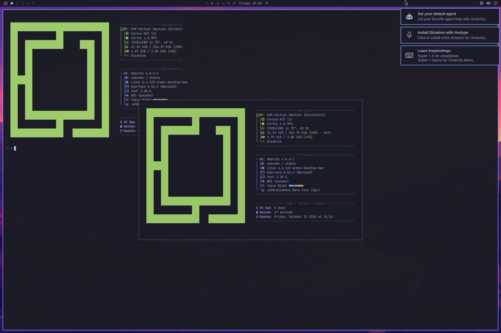

# Route C: the whole Omarchy OS in the 鸿融 Linux VM

鸿融 (`com.huawei.medivh`) is Huawei's own Linux VM app for HarmonyOS PCs. Like
Oseasy it runs StratoVirt on the HarmonyOS hypervisor and shows the guest in a
native window, but it is built for Linux guests: it gives them a `virtio-gpu`
display that stock kernels drive. That is enough to put Omarchy's Hyprland
desktop on screen.

Omarchy runs as a second OS next to a deepin 25 guest: Arch Linux ARM lives in
a directory on deepin's data partition and boots deepin's kernel.



## Status

Verified on a MateBook 14 (HongMeng kernel 1.11.13.0), 鸿融 1.3.1.80:

- Omarchy 4.0.6 (stable channel packages, plus the quattro branch's aarch64
  package list) with Hyprland 0.56.2 boots to the SDDM greeter, logs in, and
  runs the desktop: Quickshell bar, notifications, foot, fastfetch.
- Kernel: deepin's 6.6.143-arm64-desktop-hwe. Root: `/arch` on deepin's data
  partition (ext4), mounted by an mkinitcpio hook.
- GRUB (deepin's) boots Arch by default; deepin stays one menu entry away.
- Network and ssh work from the HarmonyOS host.

Open:

- **No GPU acceleration.** Rendering is llvmpipe, so animations are slow. The
  host has a virgl path but turns it off for Linux guests (see
  [findings](findings.md#鸿融-linux-vm)).
- No Snapper/Limine snapshots (ext4 root, deepin's GRUB), and ufw is off: it
  fails to load its rules on deepin's kernel and would block sshd.
- The install scripts in `hongrong/` reassemble steps that were run by hand.
  They have not been run end to end on a fresh VM yet.

## Why deepin, and why its kernel

- Fedora 44 Workstation Live (aarch64) does not boot in 鸿融: after the
  firmware hands over, the VM's virtio devices are deactivated and never
  re-initialized, nothing reaches the network, and the USB controller (which
  carries the ISO) reports `BME is cleared`. The serial console goes to
  `/dev/null`, so the hang itself was not seen.
- deepin 25.2.0 community (arm64), from the TUNA mirror, boots, installs and
  runs its desktop on 6.6.143. That is a kernel >= 6.5, which hangs in Oseasy,
  so the two apps differ here (鸿融 uses its own `stratovirt-uefi-linux`
  firmware and virtio-gpu).
- 鸿融 recommends UOS V20 and KOS V10. Both need an account to download; deepin
  is UOS's community upstream and its guest tools treat it as UOS.

Borrowing a kernel known to boot avoids testing Arch Linux ARM's own
`linux-aarch64`, which may or may not boot here (not tried).

## Layout on the VM disk

```
vda2  /boot (deepin)  vmlinuz-6.6.143..., initramfs-deepinkernel.img (Arch's), grub/custom.cfg
vda5  data (deepin's /persistent, /home, /var)
      └── arch/       the Arch Linux ARM + Omarchy root
```

The kernel command line is `root=UUID=<vda5> subroot=arch rw`. The `subroot`
initcpio hook (`hongrong/initcpio/`) mounts the partition and bind-mounts
`/arch` as the new root.

## Install

On the HarmonyOS PC:

1. Install deepin 25 in 鸿融: put the ISO in 下载 (Downloads), then 鸿融 → 本地文件
   → the ISO → 开始安装, and allow access to 下载. The installer takes the whole
   virtual disk.
2. In deepin, give the NIC an address. The bridge (`172.16.100.1/24`, NAT to
   the host's network) has no DHCP:

   ```sh
   sudo nmcli con add type ethernet ifname enp0s6 con-name lan ipv4.method manual \
     ipv4.addresses 172.16.100.2/24 ipv4.gateway 172.16.100.1 ipv4.dns 223.5.5.5
   sudo nmcli con up lan
   sudo apt update && sudo apt install -y openssh-server
   ```

   The connection name of deepin's default profile is Chinese, which the VM's
   key injection cannot type, hence a new profile.
3. Don't install 鸿融's guest tools (虚拟机增强服务, `vm-agent`) on deepin. Its
   postinst only handles UOS and Kylin, fails halfway and leaves dpkg wanting a
   reinstall, which blocks apt. If that happened:
   `sudo dpkg --remove --force-remove-reinstreq vm-agent`.
4. Copy `hongrong/` into deepin and run, as root:

   ```sh
   hongrong/10-bootstrap-arch.sh <user> <password>
   reboot
   ```

   It extracts Arch Linux ARM into `/persistent/arch`, copies deepin's modules
   in, builds the initramfs, sets up the user, sshd and the network, and adds
   the default GRUB entry.
5. In Arch, as root:

   ```sh
   ~<user>/hongrong/20-install-omarchy.sh <user>
   reboot
   ```

6. Log in at the SDDM greeter.

To boot deepin once: `grub-editenv /boot/grub/grubenv set next_entry=0` from
deepin, or mount vda2 from Arch and set it there.

## What differs from an ISO install

The scripts follow the ISO's order: repositories and keys, packages,
`omarchy-apply-system --install-user USER --first-install`, then
`omarchy-provision-user --force --first-install` as the user. Changes:

- **Repositories.** The stable `omarchy` package's `omarchy-apply-pacman`
  writes the x86 templates, so `hongrong/etc/pacman.conf` (the quattro branch's
  aarch64 template) is put back afterwards. Mirrors: TUNA for Arch Linux ARM,
  `pkgs.omarchy.cn` for `[omarchy]`. Omarchy's regional profile is x86-only,
  but the `.cn` host serves aarch64 packages too, about 30x faster than `.org`
  from mainland China here.
- **Packages.** `omarchy-base.packages` and `omarchy-aarch64.packages` from
  the quattro branch (pinned commit in the script): 678 packages, about 2 GB.
  All of them resolve on aarch64.
- **User.** The user existed before `omarchy-settings` filled `/etc/skel`, so
  the skeleton is copied in.
- **Snapper.** `install/config/snapper.sh` fails without btrfs/snapper; it runs
  with `OMARCHY_SNAPPER_CONFIGURE_TEST=1` instead.
- **Network.** `apply-system` retires systemd-networkd for NetworkManager, so
  the static address is a NetworkManager keyfile (`hongrong/etc/`).
- **Firewall.** ufw disabled (see Status).
- **SDDM.** Omarchy's greeter has only a password field and logs in
  `userModel.lastUser`. On a fresh install nobody has logged in through SDDM,
  the user name is empty and every login fails ("User not known to the
  underlying authentication module"). `/var/lib/sddm/state.conf` names the
  user.
- **Node.** `omarchy-provision-user --first-install` switches to the ISO
  context and looks for a bundled x64 Node tarball in `/opt/packages`. With
  `OMARCHY_SETUP_CONTEXT=provision-owner` it falls back to `mise` over the
  network (npmmirror).

## Driving it

- Host: an ssh server on the HarmonyOS host (`ohdev`). For screenshots and
  input it needs hdcd's access token; `tools/ohdev/ohui` runs every UI command
  through it. The deepin and Arch guests are reached through the host with
  `ProxyCommand ssh ohdev toybox nc %h %p` (the host's sshd does not forward
  ports, so `-J` fails).
- Input: `uitest uiInput keyEvent` reaches the VM, `inputText` does not.
  `ohui type` sends one key event per character; back to back the VM drops
  keys, so it waits 50 ms between them. Check focus first: key events go to
  whichever HarmonyOS window is in front.
- Hyprland in this Omarchy uses the Lua config, so `hyprctl dispatch` takes a
  Lua dispatcher, for example from ssh:

  ```sh
  export XDG_RUNTIME_DIR=/run/user/1000
  export HYPRLAND_INSTANCE_SIGNATURE=$(ls -t /run/user/1000/hypr | head -1)
  hyprctl dispatch 'hl.dsp.exec_cmd("xdg-terminal-exec bash -c \"fastfetch; exec bash\"")'
  ```
