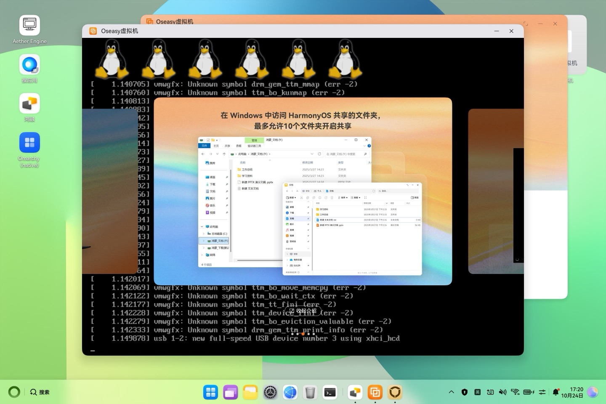
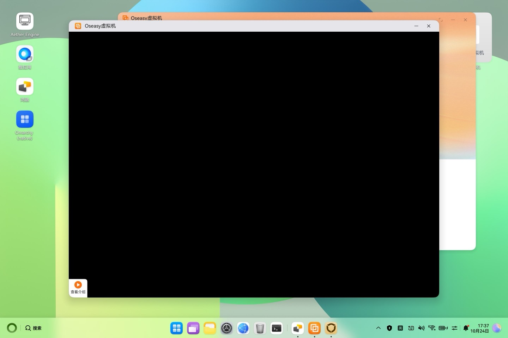
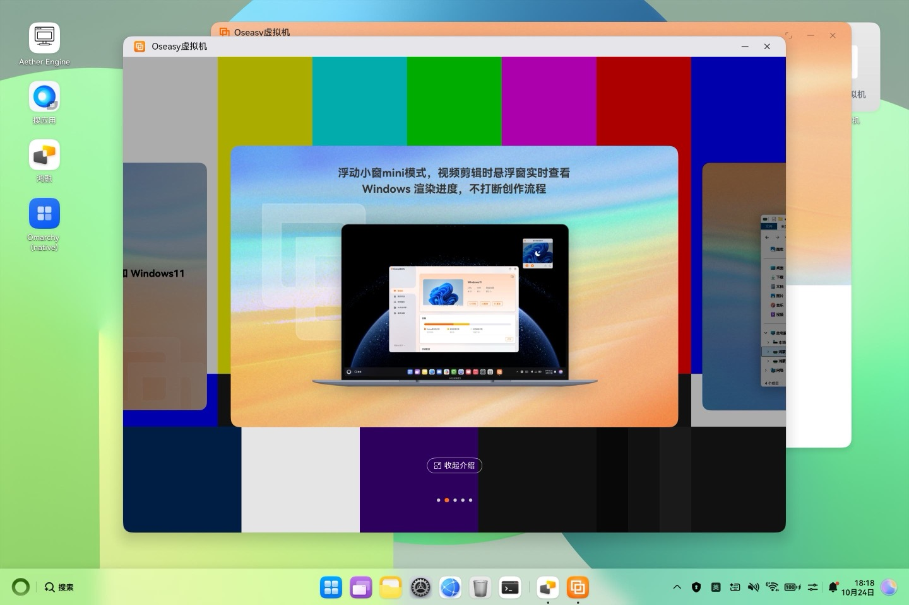
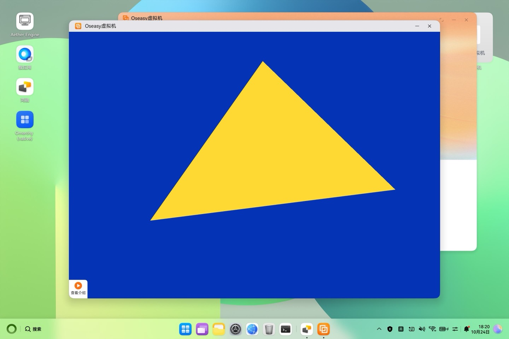
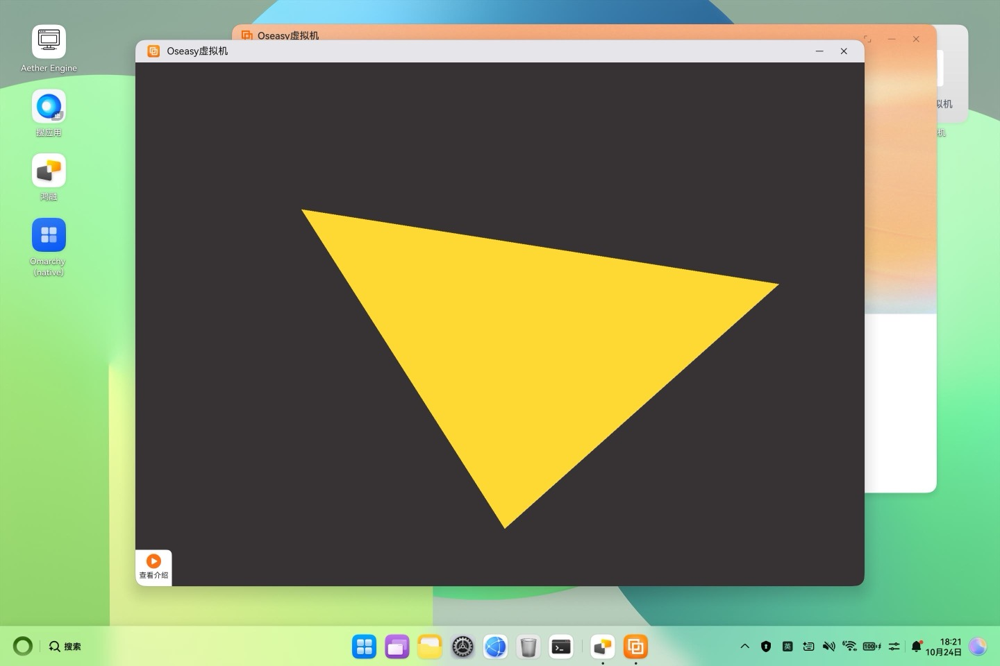

# Route B: the whole Omarchy OS in the Oseasy VM

[Oseasy虚拟机](https://appgallery.huawei.com/) (`com.oseasy1.ohvm`, AppGallery) is a
Windows-on-ARM VM app for HarmonyOS PCs. It runs StratoVirt on the HarmonyOS
hypervisor and shows the guest in a native window. It accepts any ISO after two
warnings, so it can run a complete Omarchy AArch64 install.

## Status

Verified on a MateBook Fold, HarmonyOS 7.0.0.111, Oseasy 3.1.0. The current
development machine (`ohdev`) is a MateBook 14 HM740, HarmonyOS 7.0.0.115; see
[MateBook 14 (ohdev)](#matebook-14-ohdev-2026-10-24) below.

On the Fold:

- The Omarchy disk image installs from a remastered Debian installer ISO.
- The Limine menu shows in the VM window and boots the 6.1 entries.
- Debian's 6.1 kernel boots Omarchy's root (systemd, NetworkManager, SDDM). The
  console is visible on the EFI framebuffer, and the network root shell works in
  the initramfs and in the running system.
- Omarchy's own 7.x kernel hangs early in this VM, as did every kernel >= 6.5
  tried here and in a community report. Use 6.1.

Open:

- **Desktop display.** With only the EFI framebuffer there is no DRM device, so
  SDDM's Hyprland greeter cannot start. The SVGA driver
  (`driver/vmwgfx-oseasy`) binds the Oseasy SVGA device with 3D, DX/SM4 and
  guest-backed objects, but once it enables SVGA mode Oseasy stops refreshing
  the window. Neither screen-object nor legacy-mode output reaches it. Next
  candidates: 3D surface presents through the SVGA path, and the
  `omarchy_gpu=efidrm` entry (KMS on the EFI framebuffer, software rendering).
- The pipeline in `oseasy/` reproduces the manually verified steps from public
  inputs (Omarchy release image, Debian packages). A full end-to-end run on the
  Fold with a fresh image is still pending: the first-boot module install and
  the tty1 first-boot wizard on a fresh image have not been exercised yet.

## Build

See the quick start in the [README](../README.md). The result is
`work/omarchy-install.iso`: the Debian 12 arm64 netinst ISO plus
`omarchy.raw.gz` (the Omarchy disk with the 6.1 boot entries in its ESP),
`omarchy-write.sh` and `write-esp.sh`.

Boot entries written to the ESP (`oseasy/limine.conf.in`):

| Entry | Kernel command line extra | Purpose |
|---|---|---|
| EFI framebuffer | (none) | default: console on efifb, Omarchy userspace |
| hold in initramfs | `omarchy_hold=1` | stops before the root mount for debugging; `touch /run/omarchy/go` continues |
| efidrm KMS | `omarchy_gpu=efidrm` | experimental: `omarchy_efidrm` provides card0 on the EFI framebuffer |
| SVGA 3D driver | `omarchy_gpu=svga` | experimental: `vmwgfx` with `hvm_mmio=1 hvm_display=2` |
| stock 7.x kernel | | Omarchy's own UKI, kept for reference (hangs) |

## Install in Oseasy

1. Push the ISO: `oseasy/60-push-iso.sh` copies it to the Download folder (下载).
2. Open Oseasy虚拟机 → 立即创建 → **点击选择 ISO** → pick `omarchy-install.iso`
   in 下载 → it reports 镜像不符合要求 (系统架构: 未知) → 下一步 →
   **继续安装** → **仍要安装** → keep the default 6 cores / 8 GB / 128 GB →
   开始安装 (a low-battery prompt may appear; charge the machine).
3. The VM opens on the installer's GRUB. Choose *Advanced options → Rescue
   mode*, then: English → United States → American English → network
   autoconfiguration fails, so Continue → *Do not configure the network at this
   time* → hostname Enter → time zone Enter → "No partitions found" Continue →
   *Execute a shell in the installer environment* → Continue.
4. In the shell: `sh /cdrom/omarchy-write.sh` (writes the disk, about 6 to 8
   minutes), then `sync; reboot -f`. The VM boots its disk before the installer
   media, so it now comes up in the Limine menu.
5. Oseasy's main window waits for a Windows install and later reports
   安装过程出现异常. Press 确定; the VM keeps running.

Typing into the VM from the host: `tools/fold/type.sh 'command'` (keep
commands short and without single quotes), `tools/fold/key.sh 2054` (Enter),
`tools/fold/shot.sh name` (screenshot).

## First boot

Pick **EFI framebuffer**. The initramfs:

- gives the VM NIC `172.16.100.2/24` (the HarmonyOS side of the bridge is
  `172.16.100.1`; there is no DHCP) and serves a root shell on tcp/5000;
- installs Debian's 6.1 modules into Omarchy's root from the ESP
  (`/ohmarchy/modules-<kver>.tar.gz`), since the root only carries modules for
  Omarchy's own kernel;
- blacklists autoloading of `vmwgfx` (its probe takes the framebuffer and then
  fails on this device), keeps NetworkManager off the VM NIC, allows the bridge
  subnet in ufw, and installs `omarchy-netremote.service` for the running
  system.

Omarchy's first-boot wizard (owner account, keyboard, hostname, time zone) runs
on tty1 before SDDM; answer it with the keyboard in the VM window.

## Network shell

From the host: `tools/fold/guest.sh 'uname -a; ip -br addr'`. The HarmonyOS
shell may open outgoing TCP connections (`netcat`) but not listening sockets,
so the guest always listens:

| Port | Service |
|---|---|
| 5000 | root shell (busybox `tcpsvd`) |
| 5001 | upload: first line is the destination path, then the bytes |
| 5002/5003 | one-shot transfers used by `tools/fold/guest-put.sh` and `guest-get.sh` |

## Reinstall or reset

- Closing the VM window asks 创建尚未完成，确定退出 → 确定 → 安装失败 →
  **再次安装** recreates the disk and boots the ISO again. This wipes the
  Omarchy disk.
- `write-esp.sh` rewrites only the ESP from the ISO and keeps the root
  filesystem. It needs the installer booted again.
- To reset the app completely: `hdc shell bm clean -n com.oseasy1.ohvm -d`.

## MateBook 14 (ohdev), 2026-10-24

Second device: HUAWEI MateBook 14 `HM740-001`, HarmonyOS `7.0.0.115`
(OpenHarmony 7.0.0.120), HongMeng kernel 1.11.13.0. Survey script:
[`oseasy/probe.sh`](../oseasy/probe.sh) (read-only).

### What Oseasy is

- `com.oseasy1.ohvm` **3.1.1.7** (versionCode 3110007), vendor 武汉噢易云计算股份有限公司,
  `appDistributionType: app_gallery`, `installSource: pre-installed`, compiled
  with SDK 6.1.1.125. The HAP is 290 MB, of which 227 MB is
  `resources/rawfile/oetool.iso` (the Windows guest tools). Native code is only
  `libentry.so`/`libcommon.so`; the app does not run a VMM itself.
- It asks for no virtualization permission of its own. The VM is described to
  the system `@ohos.virtualization` kit (strings in `ets/modules.abc`:
  `cpuNum memorySize diskSize biosPath graphicDevice xres yres
  accelerationEnabled storageDevice networkDevice …`,
  `virtualization.on('vmMemoryChange')`), and `vm_manager` (uid `hwf_service`)
  starts StratoVirt for it. Its VM lives next to 鸿融's under
  `/data/service/el0/virt_service/100/vm_manager/<appid>/com.oseasy1.ohvm/img/`
  (`vm.qcow2` + `stratovirt-vars`); here the app id is `68eaa5b5` and the disk
  holds a Windows 11 install from 2026-10-23.
- Image intake (resource strings): a Windows 11 ARM ISO (download from Microsoft
  or local file), **or an imported `.qcow2`** (导入虚拟机镜像 / 自动查找 .qcow2 镜像,
  with the warning 请您确保当前qcow2文件是ARM架构Windows虚拟机文件). Nothing in
  the strings points at a signature or checksum on the image; the ISO check is
  an architecture probe (`iso_validate_result`, 系统架构: 未知 on the Fold) that
  can be overridden. Licensing: a one-time trial per device, then purchase
  (每台终端仅1次试用机会).
- The app also carries a small agent client for Linux guests: it connects to
  `tcp://172.16.100.2` and speaks a length/tag framed protocol with the commands
  `heartbeat shutdown reboot stop-linux stopvm-async install_complete
  auth_confirm` (`initLinuxSupport` / `removeLinuxSupport`).

### The VMM

Oseasy's last start (`/data/log/hwf_service/vmlog4`, 2026-10-23 09:38, pid 15337):

- `stratovirt` (`/system/bin/virt_service/vm_engine/stratovirt/stratovirt`),
  `hypervisor: Hmv` (it holds `/dev/hmv`, `crw-rw---- root:hwf_service 10,232`,
  like 鸿融's StratoVirt), 6 vCPUs, 8 GB, `mem_share`.
- Firmware: `/system/opt/virt_service/virtualized_hwf/stratovirt-uefi` (鸿融's
  Linux VM uses `stratovirt-uefi-linux`), vars in the app's `img/`.
- Disks: `vm.qcow2` on virtio-blk (io_uring, discard), the install ISO and
  `oetool.iso` as USB storage on xHCI.
- Display: `svga-pci` plus `-display ohui`. Its backend is
  `devices/src/display/svga/processor_dx/*`: SVGA3D guest-backed surfaces,
  VGPU10 (DX10/SM4) command and DXBC shader parsing, executed on D3D11 through
  DXVK on Vulkan (`stratovirt_d3d11.log`: `D3D_FEATURE_LEVEL_11_1`, presenter
  `VK_PRESENT_MODE_MAILBOX_KHR`, 5 images), plus a DXVA2 video decoder. The guest
  surface follows the host window (`HostWindowInfoEvent 2100x1511` →
  `update surface size`). 鸿融 gives Linux guests virgl (`vhost-device-gpu`,
  zink on Maleoon) instead.
- The Windows display driver in `oetool.iso` (`driver.zip` → `driver1/wddm/`) is
  VirtualBox's VMSVGA WDDM stack: `SVGAMPWDDM.sys` with the user-mode
  `VBoxDX`, `VBoxGL`, `VboxSVGA`, `VboxNine`, `VboxDispD3D` DLLs (ARM64EC and
  Win32), dated 2026-10-09. StratoVirt's command table also carries VirtualBox's
  `VBSVGA_3D_CMD_*` extensions. So the device follows VirtualBox's VMSVGA (whose
  DX11 backend also runs on DXVK), not VMware's; Linux guests on VirtualBox
  drive VMSVGA with `vmwgfx`. The rest of `driver.zip` is virtio-win
  (viostor, netkvm, viofs, vioinput, vioserial, pvpanic, balloon, viogpudo).
- Host state the presenter checks (StratoVirt strings): `in_svga_stage`,
  `need_refresh_frame`, `need_change_resolution_list`, `last_blit_surface`;
  messages `svga driver not ready, avoid present`, `has no last blit surface`,
  `Set resolution end, send irq to guest driver to refresh resolution list`.
  The screen is presented from a surface the guest blits
  (`dxvk_IDXGISwapChain2_PresentEXT`, `BlitResourceEXT1`), which matches what
  the Fold saw: enabling SVGA mode turns off the VRAM framebuffer path, and
  nothing reaches the window until the guest blits to a screen.
- Other devices: USB keyboard and tablet, virtio-multitouch, virtio-net (tap,
  2 queues), `ivshmem-scream` audio, virtio-serial ports for the vendor agent,
  vhost-user-fs, balloon, pvpanic, a log device. The serial console is
  `RedirectToLog`.
- In this log only Oseasy's VM runs (鸿融's VMs were created later the same
  day), so whether both apps can run at once is not answered yet.

Sources: [Oseasy launch coverage, mydrivers](https://news.mydrivers.com/1/1048/1048600.htm),
[unwire.hk hands-on (ISO install)](https://unwire.hk/2025/05/12/harmonyos-windows11/notebook/),
[ithome](https://www.ithome.com/0/940/942.htm).

### Display: what changes with a 7.2 guest

- The host accepts the screen-object path in principle: StratoVirt's SVGA
  command table has `SVGA_CMD_DEFINE_SCREEN`, `SVGA_CMD_DEFINE_GMRFB`,
  `SVGA_CMD_BLIT_GMRFB_TO_SCREEN`, `SVGA_3D_CMD_BLIT_SURFACE_TO_SCREEN`,
  `SVGA_3D_CMD_PRESENT` and `SVGA_3D_CMD_DX_PRESENTBLT`, and the Windows driver
  generates the same blits (`SvgaGenBlitSurfaceToScreen`,
  `SvgaGenBlitGMRFBToScreen`). Writes to `SVGA_REG_WIDTH`/`HEIGHT`/
  `BITS_PER_PIXEL` are refused (`Not supported register 2/3/7` even for the
  Windows driver), so there is no legacy mode at all.
- Linux 7.2's vmwgfx backs dumb buffers with GB surfaces when the device has
  MOBs and 3D (`vmw_dumb_create`), so the fbdev console and any dumb-buffer
  client already present through `SVGA_3D_CMD_BLIT_SURFACE_TO_SCREEN`; on 6.1
  they went through `BLIT_GMRFB_TO_SCREEN`. That is the first thing to test.
- With root on the host, StratoVirt's log (`/data/log/hwf_service/vmlog*`) shows
  the SVGA backend's complaints and the guest's serial console
  (`RedirectToLog`), which the Fold's `hdc` shell could not read.
- Mesa in Arch Linux ARM ships the SVGA gallium driver (`vmwgfx_dri.so`).

`driver/vmwgfx-oseasy-7.2/` is Linux 7.2.12's vmwgfx with the 6.1 changes
ported ([patch against v7.2.12](../driver/vmwgfx-oseasy-7.2/hvm-oseasy-vs-linux-7.2.patch))
and new module parameters:

| Parameter | Default | Effect |
|---|---|---|
| `hvm_mmio` | 0 | registers through the 16-byte MMIO BAR0 (required here) |
| `hvm_display` | 0 | 2 = screen objects (the host rejects screen targets) |
| `msg_enabled` | 1 | 0 = no VMware backdoor RPC (it would trap on HMV) |
| `hvm_refresh` | 60 | refresh rate written into the reported modes (the panel does 120) |
| `hvm_vblank` | 1 | timer vblank (vmwgfx's vkms code) at that rate; normally enabled only through VMware guestinfo |
| `hvm_dumb_bo` | 0 | 1 = dumb buffers as plain BOs (GMRFB blits), for A/B tests |

`oseasy/vmwgfx-7.2/build.sh HEADERS.pkg.tar.zst` builds the `vmwgfx-oseasy`
pacman package against an unpacked `linux-aarch64-headers` (nothing is installed
in the build environment); it puts the module in `updates/` and the options in
`/etc/modprobe.d/vmwgfx-oseasy.conf`. Not built yet: waiting for the 7.2.12
`linux-aarch64` package with the HMV patches.

`oseasy/vmlock.sh take|show|drop` handles the host's one-VM lock.

### Boot probe

`oseasy/probe/build.sh OUTDIR KERNEL.pkg VMWGFX.pkg` (as root in Arch Linux
ARM; tools are fetched with `pacman -Sw` and unpacked, nothing installed) makes
`oseasy-probe.iso` (El Torito) and `oseasy-probe.img` (GPT, for a qcow2 import)
with the same ESP: standalone GRUB, the 7.2 kernel, an initramfs with busybox,
kmod, modetest and the vmwgfx-oseasy module. [`init`](../oseasy/probe/init)
reports the PCI devices, brings the NIC up as `172.16.100.2/24`, serves a telnet
root shell on port 5000, and for the vmwgfx entries loads the module and runs
`modetest -v` for 30 s (test pattern plus page-flip rate). Everything is also
written to the serial port, which ends up in the host's `vmlog`. Boot entries:
EFI framebuffer only; vmwgfx with surface-backed dumb buffers at 120 Hz
(default); the same with BO-backed dumb buffers; vmwgfx with `hvm_trace` and
DRM debug at 60 Hz.

### One VM per app: backup of the Windows VM

The import is the system call `virtualization.importVmDiskImage('com.oseasy1.ohvm',
srcFilePath, srcFileSHA256, isForceImport)`: the VM name is the bundle name, and
the kit's errors include `Not support vm multi-instance.` So Oseasy holds one VM,
and importing Omarchy replaces the Windows 11 VM. The import hashes the qcow2
(SHA-256) first, may ask for a password or report a missing key (for Oseasy's own
exports), and then offers a forced import (`openForceImportDialog`,
`isForceImport`).

Backup taken 2026-10-24 16:07 CST with the VM stopped (no StratoVirt for
`68eaa5b5`), source read-only, at
`/data/local/backup/oseasy-win11-20261024/` (`el0/` = the `img/` and
`snapshot/` directories, `el2/` = `config/`); source and copy hashed file by file,
identical:

| File | Size | SHA-256 |
|---|---|---|
| `el0/com.oseasy1.ohvm/img/vm.qcow2` | 25 260 523 520 | `ebe808fabdb18fa325b46f56d972a31d9b69843e7f65e3bc23fda23452a02347` |
| `el0/com.oseasy1.ohvm/img/stratovirt-vars` | 4 194 304 | `63838440831f786e9f9d88e686b73166425f23222f27ec51cdfde0b4fbbb0e83` |
| `el2/com.oseasy1.ohvm/config/version.json` | 111 | `44e5bb91ccc752f8a888b8a66d58cdb8e02802b8834c84a6203c4c064842ad1f` |
| `el2/com.oseasy1.ohvm/config/vmdevice.json` | 153 | `3ce539f2fb7351160c9badf711efc95fa740caf552d5ab8fa5c2e3e122649586` |

### Measuring frames on screen

`oseasy/measure-fps.sh [SECONDS] [WINDOW]` reports the panel mode, the frame rate
from RenderService's `composer fps` timestamps (and a window's `fps`), and the
per-second `DoComposition` / `HwcPresentDisplay` / `NativeWindowFlushBuffer`
counts from a hitrace capture: the same sources as the native/鸿融 table in
[native-desktop.md](native-desktop.md), where 鸿融 shows 60 frames/s on screen and
native 117.

Built 2026-10-24 16:25 against agent-2a's `linux-aarch64` 7.2.12-1.1 (HMV patches,
`hongrong/kernel/pkgbuild/`, package sha256 `0c54d8e5…d3f2f3`, headers
`7ba11471…fdd6f6`, checked against its `SHA256SUMS`), on the host under
`/data/local/oseasy/`:

| File | Size | SHA-256 |
|---|---|---|
| `vmwgfx-oseasy-7.2.12-1-aarch64.pkg.tar.xz` | 118 944 | `9dfdd303395fc36145d94157f45a0783659bf983bf4c70c86dd90c89c03b62bc` |
| `oseasy-probe.iso` | 209 373 184 | `83cf51f49cc1a122be519246f603272c95188fc7450b72e520886f8d582b8077` |
| `oseasy-probe.img` (raw GPT) | 123 731 968 | `6ba4399ac157939d76dcf4a009c20fe28fa6120a9c1977f41381cfba3ddbc734` |
| `oseasy-probe.qcow2` (from the raw disk, qemu-img 11.1.2) | 87 490 560 | `458f2f54959da4810b3fcd7705993eec779bf7bea073872e7f7b404a59c15662` |

The ISO and the qcow2 are also in the Download folder (下载), owned
`20001006:file_manager`, mode 640, like the other images there.

### First run on the MateBook 14 (vm.lock slot 16:38-18:38, 2026-10-24)

鸿融's main VM powered off from inside the guest (16:42), Oseasy's Windows VM shut
down from its Start menu and deleted in Oseasy (backup above, its SHA-256
re-checked just before), then a new VM from `oseasy-probe.iso` through
立即创建 → 从U盘或本地导入 → 镜像不符合要求 (系统架构: 未知) → 下一步 → 继续安装 →
仍要安装 → 6 cores / 8 GB / 256 GB → 开始安装. In this app version the create
flow only offers ISOs; the qcow2 import is not reachable from it.

- **Linux 7.2.12 boots in Oseasy** with `arm64.hmv_idreg_quirk` (all 6 vCPUs up,
  initramfs shell, NIC as `172.16.100.2`, telnet from the host works). The
  "every kernel >= 6.5 hangs" finding from the Fold was the same HMV ID-register
  problem as in 鸿融.
- The guest's serial console lands in `/data/log/hwf_service/vmlog` as
  `chardev.rs:207` lines: the whole boot log is readable on the host.
- The kernel's own module autoload went through busybox `modprobe`, which ignores
  `updates/`, so the in-tree vmwgfx loaded first and crashed on the MMIO BAR used
  as an I/O port (`vmw_detect_version`, address `PCI_IOBASE + 0x20227100`). The
  probe now points `/proc/sys/kernel/modprobe` at kmod and leaves the in-tree
  vmwgfx out.
- vmwgfx-oseasy 7.2 binds: SVGA 2, 3D, DX, SM4, GB objects, screen objects,
  VKMS vblank; `card0` + `renderD128`; preferred mode `2100x1511` at **120.00 Hz**
  (the host window size). The host logs `define screen w 2100 h 1511` and DXVK
  creates a `2100x1511` mailbox swapchain.
- With fbdev on a surface-backed dumb buffer the window turns **black but is
  being presented**: while the guest writes to `/dev/fb0` in a loop, the host
  composes 58 frames/s and the VM window receives 54 buffers/s
  (`NativeWindowFlushBuffer`). The blits arrive; the host's copy of the surface
  (a D3D11 texture) never gets the guest's CPU writes. vmwgfx relies on the host
  reading the backing MOB (as VMware does) and only uploads regions that its
  mkwrite-based dirty tracking caught, which kernel-side fbdev writes bypass.
  Uploading the whole surface (`SVGA_3D_CMD_UPDATE_GB_SURFACE`) before every
  screen-object blit (now in `vmw_kms_sou_do_surface_dirty` under `hvm_mmio`)
  does not change it: still black. Working guess: the host presents only
  surfaces that exist as textures on its DX device (all of the Windows driver's
  screen content is GPU-rendered), and a dumb surface that was only ever written
  by the CPU has none. Next test: GPU rendering through Mesa's SVGA driver on KMS
  (kmscube) in the probe.

  
  

  Raw data: [`oseasy/runs/2026-10-24-probe/`](../oseasy/runs/2026-10-24-probe/)
  (serial consoles from the host log, the host's SVGA/ohui lines at bind, the
  guest's dmesg).
- With BO-backed dumb buffers (`hvm_dumb_bo=1`, GMRFB blits) the host does not
  even switch away from the firmware framebuffer: the window keeps showing the
  last EFI-framebuffer frame, and the host logs nothing.
- While Oseasy shows a VM, the host panel stays at 60 Hz (`activeMode`), with the
  Windows guest too.
- Unloading vmwgfx crashes in this setup; reboot the guest (`sysrq b`) instead.

### Where the black frames come from (offline, StratoVirt disassembly)

- The present path (`svga_dx_backend.rs`, around `0x2e4500` in the stripped
  binary) logs `svga driver not ready, avoid present`, `swap_chain is None` and
  `back surface not find` at WARN level, which `vmlog` records (it records INFO).
  None of them appeared during the probe runs: the host found the blitted
  surface and presented it. The texture it presented was black.
- Besides the standard GB-object commands, StratoVirt's table has VirtualBox's
  newer `SVGA_3D_CMD_DX_MAP_RESOURCE`, `SVGA_3D_CMD_DX_PAGING_RESOURCE` and
  `SVGA_3D_CMD_DX_CMO_RESOURCE`, with messages such as `Paging resource transfer
  size or offset is invalid`. A likely reading: the Windows driver moves CPU data
  into host textures with these, and `UPDATE_GB_IMAGE`/`UPDATE_GB_SURFACE` do not
  fill the host's D3D11 copy. Not followed up until the GPU-rendering test
  (kmsgl) shows whether GPU-rendered surfaces display.

`oseasy/probe/kmsgl.c`: GBM + EGL + GLES2 straight on KMS (Mesa's SVGA gallium
driver), rotating triangle on an animated background, page flips, prints
`GL_RENDERER`, frames per second and the first frame's centre pixel. The probe
ISO now carries it with Mesa's `vmwgfx_dri.so`, `libgallium` and `libLLVM`
(ISO 394 MB). The probe ISO in 下载 is replaced in place between runs (it is only
referenced by Oseasy's VM): `6d13d26f…bce4f30` (run 1) →
`46e1044a3f44d8735c6b45e8c3992b51f38255e7f1003ef8b7666e6b5e8c376d` (kmsgl).

### Second run: the window shows the guest's KMS output, GPU-accelerated (18:12-18:27)

Same Oseasy VM (再次安装 after its "安装失败" dialog boots the replaced probe ISO),
vmwgfx-oseasy with the whole-surface upload before screen-object blits, options
from the kernel command line:

- **`kmsgl` renders on the host GPU and the window shows it.** `GL_RENDERER
  SVGA3D; build: RELEASE; LLVM;`, `OpenGL ES 3.0 Mesa 26.2.5`: Mesa's SVGA
  hardware driver, not llvmpipe. First frame's centre pixel read back as
  `255 217 51` (the triangle's colour). The rotating triangle on its changing
  background is in the window.
- **`modetest`'s colour bars show** too (a dumb buffer written by the CPU, page
  flipped): with the upload before the blit, CPU-written scanout buffers reach
  the window. (The fbdev console stayed black in the first run; to recheck.)
- **Guest frame rate 120:** `kmsgl` runs at 120.0 frames/s (4800 frames in 40 s),
  `modetest -v` flips at 120.00 Hz, both paced by vmwgfx's timer vblank at the
  `hvm_refresh=120` mode `2100x1511@120`.
- **The host takes 120 but shows 60:** during `kmsgl` the VM window receives 120
  buffers/s (`NativeWindowFlushBuffer`), while the panel stays in its 60 Hz mode
  and composes 60 frames/s (`composer fps`, `DoComposition`). Oseasy does not
  raise the panel to 120 Hz for its window (the Windows guest's saved modes are
  60 Hz as well). For comparison: 鸿融 shows 60 frames/s on screen with a 60 Hz
  EDID; native shows 117.

Raw data: [`oseasy/runs/2026-10-24-kmsgl/`](../oseasy/runs/2026-10-24-kmsgl/).

So the display blocker from the Fold is gone: KMS clients, and so Hyprland
(aquamarine on GBM with Mesa's SVGA driver), can show in Oseasy, with host 3D
acceleration through SVGA3D → D3D11 (DXVK) → Vulkan. Next: the Omarchy disk with
`linux-aarch64` 7.2.12 + `vmwgfx-oseasy`, booted to Hyprland; then the comparison
measurements.

### Getting the Omarchy disk into Oseasy's VM

This Oseasy version only creates VMs from ISOs, and the VM's disk lives under
`vm_manager/`, which is not touched by hand. So the disk goes in over the VM's
network, from the probe: `PROBE_DEFAULT=4 oseasy/probe/build.sh …` makes a probe
whose default entry is the install mode (`probe.install=1`): it listens on
`172.16.100.2:5003`, writes what arrives to `/dev/vda` with coreutils
`dd conv=sparse` (zeros stay unallocated in the qcow2), mounts the root
partition, adds `updates/vmwgfx.ko` and `/etc/modprobe.d/vmwgfx-oseasy.conf`
for the kernel found there and runs `depmod` (Arch's depmod searches `updates`
first, so the patched module wins over the in-tree one). On the host,
[`oseasy/push-disk.sh`](../oseasy/push-disk.sh) streams the image read-only:
`sh push-disk.sh /data/local/vmtest/omarchy-pure.img`. Then reboot the guest;
the firmware boots the disk before the ISO.

### Comparison: Oseasy vs 鸿融 vs native (filling in)

Same machine (MateBook 14 HM740, panel 2880x1920, modes 120/80/60/48 Hz). 鸿融 and
native figures are from [native-desktop.md](native-desktop.md); Oseasy figures from
the runs above unless marked pending.

| | Oseasy (Route B) | 鸿融 (Route C) | Native (Route D) |
|---|---|---|---|
| Guest display device | `svga-pci` (VMware SVGA II, VirtualBox VMSVGA-style), vmwgfx-oseasy | `vhost-user-gpu-pci` (virtio-gpu, virgl) | none (HarmonyOS window) |
| Modes offered to the guest | driver-made; `2100x1511@120` with `hvm_refresh=120` (no EDID) | EDID, 60 Hz only | `@120` |
| Guest frame rate (KMS page flips) | 120.0 (kmsgl, modetest) | 114-120 (es2gears, reported) | 114-120 |
| Frames the host window receives | 120/s (`NativeWindowFlushBuffer`, kmsgl) | 112-123/s | 116-118/s |
| Frames on screen | 60 (panel stays at 60 Hz while Oseasy shows a VM) | 60 | 117-120 |
| GPU | 3D: Mesa SVGA3D (GLES 3.0) → host D3D11 on DXVK → Vulkan (Maleoon) | 3D: virgl → zink → Vulkan (Maleoon), OpenGL only | virgl through vtest (Hyprland only) |
| Runs next to another VM | no: the system VM kit refuses (`Not support vm multi-instance`); not exercised (rule: one VM at a time) | no (same kit) | yes (no VM) |
| Cold start to desktop | pending | | |
| App launch times | pending | | |
| es2gears / glmark2 | pending | | |
| Workspace switching on screen | pending (60 at most) | 59-60 | 109-115 |
| 3 warm reboots, 1 h soak | pending | | |

### Commits (MateBook 14 work)

- [`5df801d`](https://github.com/BH3GEI/ohmarchy/commit/5df801d) Oseasy on the MateBook 14: app 3.1.1.7, VMM and SVGA backend survey
- [`b092518`](https://github.com/BH3GEI/ohmarchy/commit/b092518) Route B: name the MateBook 14 dev machine; Oseasy's guest display driver is VirtualBox VMSVGA
- [`0db08f7`](https://github.com/BH3GEI/ohmarchy/commit/0db08f7) Route B: vmwgfx for the HarmonyOS SVGA device ported to 7.2.12, with refresh/vblank parameters; package script; VM lock helper
- [`a017fb6`](https://github.com/BH3GEI/ohmarchy/commit/a017fb6) Route B: boot probe (ISO and GPT disk) for the SVGA display experiments
- [`a3abfc4`](https://github.com/BH3GEI/ohmarchy/commit/a3abfc4) vmwgfx-oseasy 7.2: builds against linux-aarch64-headers 7.2.11 (format fix); package version follows the kernel
- [`f5431ee`](https://github.com/BH3GEI/ohmarchy/commit/f5431ee) Route B: Windows VM backed up (sha256 verified) before the import; one VM per app; frame counter script
- [`499d369`](https://github.com/BH3GEI/ohmarchy/commit/499d369) Route B probe: skip .sig files, robust kernel image lookup, gzip initramfs
- [`b6bcca8`](https://github.com/BH3GEI/ohmarchy/commit/b6bcca8) Route B: probe built against the 7.2.12-1.1 HMV kernel; hashes
- [`3363034`](https://github.com/BH3GEI/ohmarchy/commit/3363034) Route B: 7.2 boots in Oseasy; vmwgfx binds at 120 Hz; frames reach the window but CPU writes do not reach the host's surface copy
- [`95f82be`](https://github.com/BH3GEI/ohmarchy/commit/95f82be) Route B: vmwgfx uploads the surface before screen-object blits (still black); run data and screenshots
- [`ed2a0b7`](https://github.com/BH3GEI/ohmarchy/commit/ed2a0b7) Route B probe: kmsgl (GPU rendering on KMS through Mesa's SVGA driver), vmwgfx reloaded with command-line options
- [`21dd140`](https://github.com/BH3GEI/ohmarchy/commit/21dd140) Route B: present path analysis; VirtualBox paging commands as the likely upload path; kmsgl probe recorded
- [`b15cf1f`](https://github.com/BH3GEI/ohmarchy/commit/b15cf1f) Route B: GPU-rendered KMS output (Mesa SVGA3D) shows in the Oseasy window; guest at 120 frames/s, panel at 60 Hz
- [`941950d`](https://github.com/BH3GEI/ohmarchy/commit/941950d) Route B probe: install mode (disk image over the VM network, vmwgfx-oseasy added), host push script
- [`60e7e23`](https://github.com/BH3GEI/ohmarchy/commit/60e7e23) Route B: comparison table skeleton with the figures so far
- [`d90b935`](https://github.com/BH3GEI/ohmarchy/commit/d90b935) Route B: guest benchmark script (renderer, es2gears, glmark2, workspace switching, app launch)

Related Route G commits: [`07528eb`](https://github.com/BH3GEI/ohmarchy/commit/07528eb) (Oseasy's Windows guest and svga-pci).
