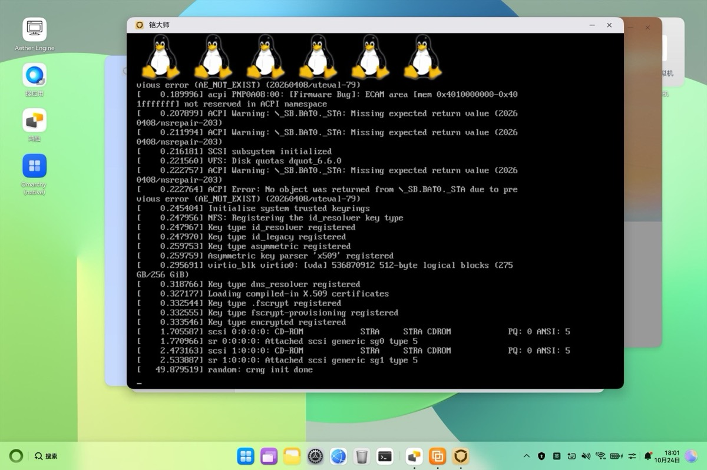
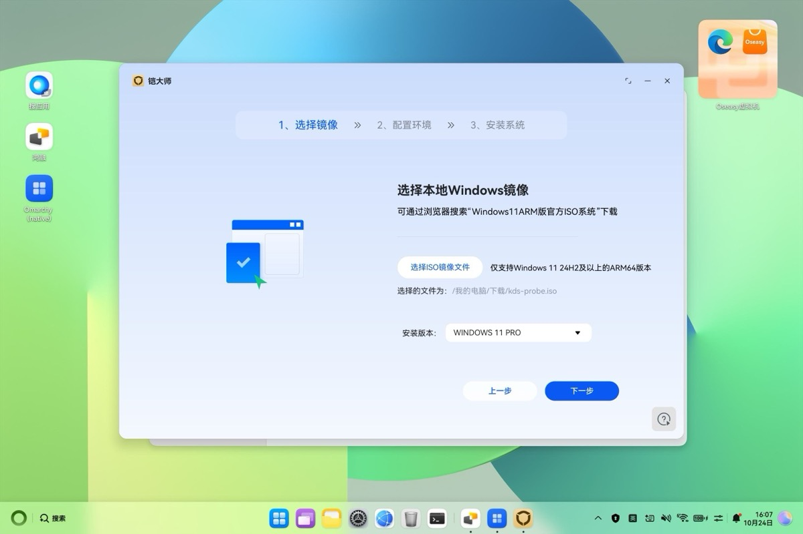
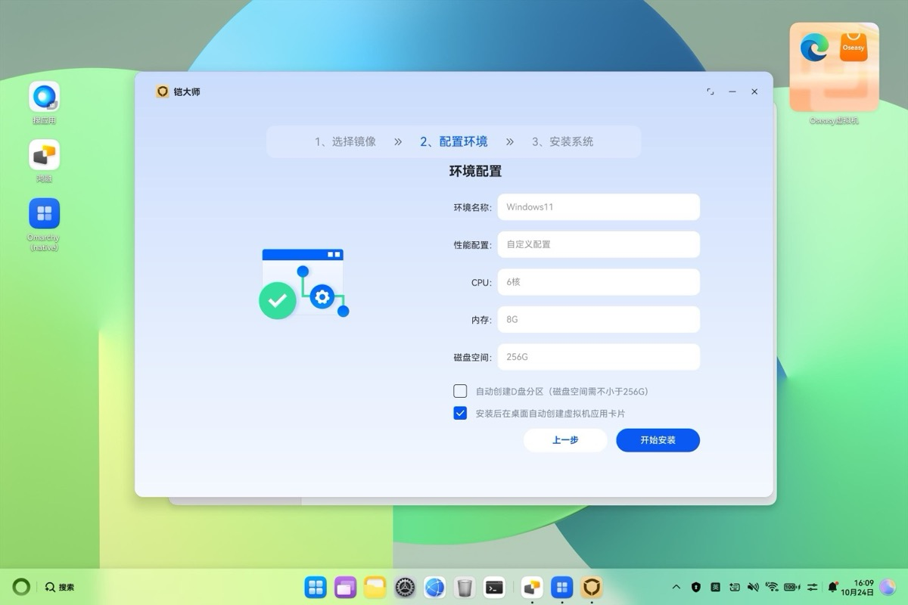
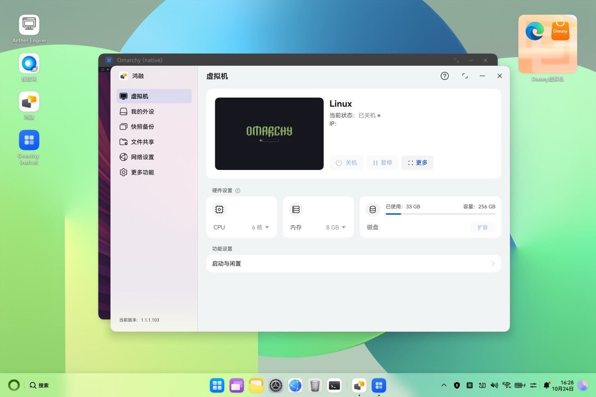
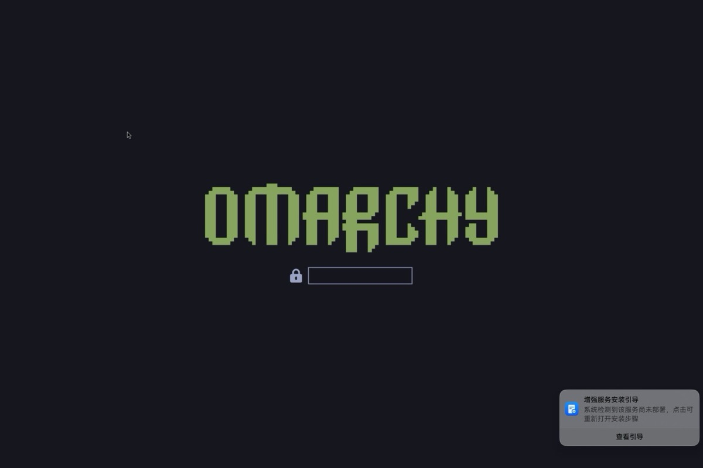

# Route G: the whole Omarchy OS in the 铠大师 VM

[铠大师](https://kaidashi.helplook.com) (`com.sanway.ecoengine`, vendor
sanway.tech / 晟为数科) is a Windows-on-ARM VM app for HarmonyOS PCs, sold on
AppGallery since the HarmonyOS PC launch in May 2025. This route tries to run
Omarchy's own disk (UEFI + GRUB, linux-aarch64 7.2 with the HMV ID-register
quirk) in it, and to compare it with 鸿融 (route C) and the native desktop
(route D).

## Status

**Concluded (2026-10-24): same `svga-pci` path as route B, 60 Hz; tools kept.**
Outcome (B) of the goal: 铠大师 cannot host Omarchy beyond an install session,
and where it does run Linux it offers nothing over 鸿融 or route B.

What works, on ohdev (MateBook 14 `HM740-001`, HarmonyOS `7.0.0.115`, HongMeng
kernel 1.11.13.0):

- Its Windows-11-24H2-ARM64-only ISO check reads only the WIM XML; a 2.5 KB
  fake `sources/install.wim` gets any UEFI ISO accepted
  (`tools/kaidashi/make-fake-wim.sh`, `wrap-iso.sh`). No login or payment is
  needed to create and boot a VM; Secure Boot is off.
- Linux boots in its VM: Debian 6.1 and Omarchy's linux-aarch64 7.2.12 with
  `arm64.hmv_idreg_quirk` (6 vCPUs, simplefb console, virtio-blk).

Where it stops, with the layer and the evidence:

| Layer | What happens | Evidence |
|---|---|---|
| App (铠大师) | Every VM the wizard starts is an *install session*. Closing its window **or a guest power-off** ends it as 安装过程异常终止 and the app deletes the VM (`InstallVmability, remove vm file destroy vm` → `DestroyVm`, `img/` gone). A guest reboot keeps it running but changes nothing | [`runs/2026-10-24-final/hilog.txt`](../kaidashi/runs/2026-10-24-final/hilog.txt): state codes 3 STARTING, 9 VIEWING, 0 STOPPED; screenshots of the three slots |
| System VM service (`libvm_manager.z.so`) | An install session ends successfully only in `HandleVmStateCallback` when the VM is RUNNING (code 1) with the installing flag set *and* two values the guest agent reports (`this+0x4a8/0x4ac`) pass a check; they come from 铠大师's Windows guest service (`setup.exe /oobe` from its `server.iso`, autounattend), over its virtio-serial protocol | disassembly below ("Ending an install session") |
| Install-session devices | NIC without MAC or iothreads (fixed string in the install builder): the guest sends but never receives. virtiofsd runs without a shared directory: `virtio-fs: response too short`. So a disk can only come in on the install ISO itself | [`runs/2026-10-24-k72`](../kaidashi/runs/2026-10-24-k72/), [`runs/2026-10-24-final/serial-35521.txt`](../kaidashi/runs/2026-10-24-final/serial-35521.txt) |
| Display (all sessions) | `svga-pci`, the same device and DXVK backend as Oseasy; no EDID; 60 Hz on the panel. Route B made vmwgfx present GPU frames (Mesa SVGA3D, GLES 3.0) with the guest at 120 Hz while the panel stays at 60 Hz; Oseasy's own Windows stack also runs this device at 60 Hz only | route B ([oseasy-whole-os.md](oseasy-whole-os.md)), "OSEasy's Windows guest" below |
| Concurrency | One VM system-wide | `Not support vm multi-instance` |

Decision rule of the goal (step 2): continue only if 铠大师 beats 鸿融 on 120 Hz
or 3D. 120 Hz: no (60 Hz panel, same as 鸿融's 60 Hz EDID). 3D: route B's
SVGA3D/DXVK path is GPU rendering like 鸿融's virgl, not shown to be better, and
in 铠大师 it could only be used inside an install session that cannot persist.
Getting a persistent Omarchy VM would need impersonating 铠大师's Windows guest
service (its protocol is in the protected `modules.abc` and `server.iso`), which
is out of scope; route B (Oseasy) already covers the `svga-pci` display path.

Kept for reuse: the fake WIM and ISO wrapper, the probe and installer ISOs
(7.2.12 + virtiofs/network/ISO writers, `sparsecp`), `kds-run.sh`,
`stage-disk.sh`, the Windows-guest inspection method, and the comparison table
below.

### Timeline

On ohdev (MateBook 14 `HM740-001`, HarmonyOS `7.0.0.115`, HongMeng kernel
1.11.13.0), 2026-10-24:

- 铠大师 3.5.8.14 drives the same system VM service as Oseasy
  (`@hms:virtService.vmManager`); `vm_manager` builds the StratoVirt command
  line, the app only picks CPU, memory and disk size.
- Its Windows-11-24H2-ARM64-only ISO check reads nothing but the WIM's XML
  metadata. A Debian 12 netboot ISO with a 2.5 KB fake `sources/install.wim`
  (`tools/kaidashi/make-fake-wim.sh`) is accepted as 安装版本 WINDOWS 11 PRO.
- **A VM was created and booted from that ISO** (16:16, during a `vm.lock` slot
  with 鸿融's VM powered off): UEFI → Debian's shim/GRUB → Debian 6.1 kernel →
  the probe script. No login, membership or payment was asked for.
- The VM is Oseasy's machine minus a few devices: `svga-pci` (VMware SVGA II
  `15ad:0405`, 256 MB VRAM, no `xres`/`yres`), Windows firmware
  `stratovirt-uefi`, one virtio-net. **Secure Boot is off** on a fresh VM
  (`secureboot: Secure boot disabled`), so an unsigned GRUB and kernel boot.
  No EDID (SVGA has none); the firmware framebuffer is 800×600 and the host
  ignores the SVGA WIDTH/HEIGHT/BPP registers (`Not supported register 2/3/7`)
  exactly as for Oseasy. Full comparison below.
- One VM at a time, system-wide (`Not support vm multi-instance`,
  虚拟机启动失败，已有虚拟机在运行中).

Decision (goal step 2): 铠大师 gives a Linux guest nothing that 鸿融 does not do
better today. Its display is Oseasy's `svga-pci`, whose Linux path (vmwgfx)
does not reach the window yet; that work is route B's
([oseasy-whole-os.md](oseasy-whole-os.md)), and a fix there applies here
unchanged (same device, same backend). Without it 铠大师 has only the 800×600
EFI framebuffer: no 3D, no EDID, no 120 Hz. Route G therefore keeps only what
is specific to 铠大师 (getting a disk in, Secure Boot, the app's behaviour) and
waits on route B for the display.

- **The 7.2.12 HMV-quirk kernel boots in 铠大师** (2026-10-24 17:54, from
  `kds-installer.iso`): all 6 vCPUs up, console on simplefb, virtio-blk
  (`/dev/vda`, 256 GiB), both install media on usb-storage, `virtio_net` binds.
  
- **Guest networking does not receive.** eth0 is up as 172.16.100.3, but the
  host cannot reach it: no ARP entry, and the tap's counters show the host
  sending (tx rising) while the guest sent 12 packets after boot and nothing
  after (two boots, same result). Route B's 7.2.12 guest on Oseasy's NIC
  does have network, so the difference is 铠大师's NIC (below).

Next: tell apart a 7.2/MSI problem from 铠大师's NIC setup (installer entries
with `pci=nomsi` and with Debian's 6.1 kernel, counters every 10 s), then
write the pure Omarchy disk and boot it on the EFI framebuffer, ready for
route B's vmwgfx.

## The app

| | |
|---|---|
| Bundle | `com.sanway.ecoengine` 3.5.8.14 (versionCode 3050814), vendor `sanway.tech`, `appDistributionType: app_gallery`, `installSource: pre-installed`, SDK 6.0.2.130, target API 60002022 |
| HAP | 472 MB, md5 `5271455c1ec9e6875df1fb071f398706`; 441 MB of it is `resources/rawfile/server.iso` (the Windows guest tools, 铠大师 "WOA server") |
| Installed | `/data/app/el1/bundle/public/com.sanway.ecoengine/entry.hap`, 2026-10-23 09:10 |
| Native code | `libentry.so` (NAPI: `extractWim`, `genIsoFile`), `7z.so`/`lib7z_.so` (7-Zip), `libgenisoimage.so`; no VMM of its own |
| Abilities | `VMConsoleAbility` (main), `VirtualAbility` (VM window), `InstallVmAbility`, `BridgeAbility`, `ReleaseServerAbility`, a form card |
| Permissions | internet, microphone, camera, pasteboard, Download/Documents, `ACCESS_USER_FULL_DISK`, `KEEP_BACKGROUND_RUNNING`, print, `PRIVACY_WINDOW`; none for virtualization |
| Licensing | account login (SMS / WeChat QR), membership and payment (`/appstore/payment`, `checkTpmChangedNoVipStartVm`, 会员) |

`ets/modules.abc` (ArkTS bytecode, ark 12.0.6.0) is protected: `ark_disasm`
from DevEco 26.0.0.105 and from SDK 6.1 both abort with "checksum mismatch",
and with the checksum fixed, "Invalid file offset, from method:
GetSpanFromId". The findings below come from its strings and from the
resource index.

Versions of the other VM apps at the same time (AppGallery auto-updates them):
鸿融 `com.huawei.medivh` 1.1.1.103, Oseasy `com.oseasy1.ohvm` 3.1.1.7.

## The VMM

Nothing in the app starts a VMM. It calls the system kit
`@hms:virtService.vmManager` (`createVm`, `startVm`, `stopVm`, `destroyVm`,
`createSnapshot`, `setVmNetMode`, `addSharedFolder`, `getGraphicDevice`,
`checkVmCapability`, …) with `cpuNum`, `memSize`, `diskSize`, `biosPath`,
`dbContent`/`dbxContent` and `accelerationEnabled`. The system `vm_manager`
(uid `hwf_service`) turns that into a StratoVirt process with `accel=hmv` on
`/dev/hmv`, the same engine 鸿融 and Oseasy use.

`/system/lib64/libvm_manager.z.so` has three display choices:

| Device | Used for |
|---|---|
| `svga-pci,id=svga,bus=pcie.0,addr=0x4.0x0[,xres=1600,yres=1200]` | Windows guests (Oseasy's VM); backend is StratoVirt's `devices/src/display/svga/processor_dx/*`, SVGA3D/VGPU10 on D3D11 through DXVK on Vulkan |
| `virtio-gpu-pci,...,xres=2160,yres=1440,enable_bar0=false[,edid=true]` | Linux guests, 2D |
| `vhost-user-gpu-pci` + `vhost-device-gpu --gpu-mode virglrenderer` | Linux guests with acceleration (鸿融's VM now) |

all with `-display ohui`. 铠大师 only creates Windows guests and gets `svga-pci`.

### Its VM, compared with Oseasy's

From `/proc/<pid>/cmdline` of 铠大师's StratoVirt (pid 38867, 2026-10-24 16:16,
[`kaidashi/runs/2026-10-24-probe/cmdline.txt`](../kaidashi/runs/2026-10-24-probe/cmdline.txt))
and Oseasy's last `VmConfig` in the same log:

| | 铠大师 3.5.8.14 | Oseasy 3.1.1.7 |
|---|---|---|
| Machine | `virt`, GICv3, `accel=hmv`, `mem-share=on`, `-cpu host,pmu=on`, 6 vCPUs | same |
| Memory | 8 GB, `maxmem=10240`, virtio-mem `requested-size=8192` | same |
| Firmware | `stratovirt-uefi` (Windows), vars in the app's `img/` | same |
| Secure Boot | off on a fresh VM (keys bundled in the HAP, not enrolled) | (not checked) |
| Disk | `vm.qcow2` on virtio-blk, io_uring, discard | same |
| Install media | the picked ISO **by its original path** (`Docs/Download/kds-probe.iso`) and `Download/com.sanway.ecoengine/server.iso`, both USB storage on xHCI | the ISO and `oetool.iso`, USB storage |
| Display | `svga-pci,id=svga,bus=pcie.0,addr=0x4.0x0` | same, plus `xres=1600,yres=1200` |
| Display backend | `-display ohui`, `/dev/shm/hwf/ohui-fb`, D3D11 on DXVK (`/dev/hvgr0`, Maleoon), `/dev/vcodec_vdec` | same |
| Input | USB kbd + tablet, virtio-multitouch touchpad | plus a virtio-multitouch screen |
| Audio | `ivshmem-scream`, `record-auth=off` | `record-auth=on` |
| Network | one virtio-net (tap) | two (tap + host-only) |
| Sharing | vhost-user-fs `shared_dir` = HarmonyOS 文档 (exported even after 不允许 on the 文档 prompt) | vhost-user-fs, no directory |
| Other | virtio-serial (6 vendor ports), pvpanic, logdevice, `-serial redirect-to-log`, `-battery` | same |

**Network.** Each VM gets its own bridge: 铠大师's tap `WVMTap14571594` sits
on `WVMBr14571594` (172.16.100.1/24, `MASQUERADE` for 172.16.100.0/24,
`FORWARD` accepted both ways); Oseasy's was `WVMBr14204819` with the same
address. Both taps are opened with `queues: 2`. The difference is the device:

| | 铠大师 | Oseasy |
|---|---|---|
| `-device virtio-net-pci` | `netdev=net0,id=nic0,bus=pcie.0,addr=0x6.0x0` | `…,mac=02:9f:…,addr=0x6.0x0,rx-iothread=rx-iothread0,tx-iothread=tx-iothread0` |
| MAC in the guest | `52:54:00:12:34:56` (StratoVirt's default; the app's `vmdevice.json` MAC `c2:82:96:65:29:d0` is not passed) | the configured one |

**Why: two command lines in `libvm_manager.z.so`** (disassembled with
capstone; addresses are file virtual addresses). The VM that 铠大师's wizard
starts is an *install session*, built by the function at `0x25d6dc`: install
ISO and unattend ISO as USB CD-ROMs, disk id `system`, and a fixed
`-device virtio-net-pci,netdev=net0,id=nic0,bus=pcie.0,addr=0x6.0x0` (string at
`0x548f7`, used at `0x25ddc0`), no MAC, no iothreads. A normal start goes
through `GetOHStartVmCmd` (`0x262c5c`): disk id `disk_image`, `-mem-swap`, and
`GetOHNetCmd` appends `,mac=…` and `rx-iothread=rx-iothread0,tx-iothread=
tx-iothread0` (`0x263d8c`–`0x263f8c`); that is the line 鸿融's and Oseasy's VMs
run with. So the NIC is only crippled during the install session.

**Ending an install session.** `HandleVmStateCallback` (`0x1bb3e0`) logs
"install finished need stop vm" when it gets state code 1 while the VM's
installing flag (`this+0xf8`) is set, then stops the VM and records the result.
Closing 铠大师's window instead aborts (安装过程异常终止) and the app deletes
`img/` (seen after both test slots). The installer therefore powers the guest
off itself after a successful write (`poweroff -f`, PSCI SYSTEM_OFF). Tested in
the last slot: it is not. A guest power-off reaches vm_manager as code 0
(STOPPED) and the app destroys the VM (`InstallVmability, remove vm file
destroy vm`); a guest reboot raises no state change at all. Codes seen: 3
STARTING, 9 VIEWING, 0 STOPPED, so 1 is RUNNING, and "install finished" also
needs the two values the guest agent reports.

Same PCI address, so the same ITS device ID; the "Devices Table too large,
reduce ids 32->19" line is not the difference. Untested idea: with a two-queue
tap and a single-queue device without its rx iothread, frames the host kernel
puts on the second tap queue may never be read.

The guest serial port ends up in `/data/log/hwf_service/vmlog` (root can read
it), so a guest console on `ttyAMA0` is the debug channel.

What the guest saw (`probe-serial.txt`, `dmesg.txt`): PCI `1b36:0008` host
bridge, `1b36:0011` pvpanic, `1af4:1042` blk, `1b36:000d` xHCI,
`15ad:0405` SVGA (BAR0 16 B MMIO at `0x20227100`, BAR1 256 MB VRAM at
`0x10000000`, BAR2 2 MB FIFO at `0x20000000`), `1af4:1110` ivshmem,
`1af4:1041` net, `1af4:1043` serial, `1af4:105a` fs, `1af4:1052` input,
`1af4:1130` mem. ACPI tables `APIC DBG2 DSDT FACP GTDT IORT MCFG PPTT SPCR`
(`STRATO`), DMI "StratoVirt Virtual Machine". efifb 800×600×32 in SVGA BAR1.
No DRM device (Debian's d-i initrd has no vmwgfx). Host side: `Svga vram size
256 Mb`, `DXVK resource passthrough is not supported`, the surface follows
the window (`HostWindowInfoEvent 2026x1455`, panel surface 2880×1920).

Bundled Secure Boot keys (`resources/rawfile/securityBoot/`), all Microsoft:
PK "Windows OEM Devices PK", KEK "Microsoft Corporation KEK 2K CA 2023",
db "Windows UEFI CA 2023", "Microsoft Corporation UEFI CA 2011",
"Microsoft Windows Production PCA 2011", "Microsoft UEFI CA 2023", dbx
"Microsoft Windows Production PCA 2011". If they are enrolled with Secure Boot
on, an unsigned GRUB will not start; shim (signed by the 2011 UEFI CA) would.

## Image intake

- Source: download (from sanway's server) or a local ISO in a public directory
  (当前不支持从应用目录安装，请选择本地公共目录镜像文件), no spaces in the path.
- Check (`CheckISOVersion.ts`, `checkIsoWorker.ets`, `extractwim.cpp`): 7-Zip
  pulls `sources/install.wim` out of the ISO, then the app reads the WIM's XML
  metadata (UTF-16LE, `XmlPullParser`) and looks at `ARCH` (must be `12`,
  ARM64), `MAJOR`/`MINOR`/`BUILD`/`SPBUILD` (`10.0.26100`, 24H2), and the
  name (`WINDOWS 11`). Failure: 镜像校验失败！当前仅支持Windows 11 24H2及以上的ARM64系统镜像安装。
- It notices a changed image afterwards (镜像被修改，请重新选择镜像！).
- No signature or checksum of the ISO in the strings. The app writes its own
  `autounattend` (arm64 components, `<RefreshRate>60</RefreshRate>`) and guest
  tools ISO with genisoimage; the install ISO is attached as `Windows_install.iso`.
- Result with the probe ISO (`tools/kaidashi/probe-iso/build.sh`, Debian
  `mini.iso` + fake WIM + Joliet names, volume id `CCCOMA_A64FRE_ZH-CN_DV9`):
  accepted. The ISO has to be in a public folder (下载) to show up in the picker.

  
  

- There is no qcow2 import in the UI (unlike Oseasy): only 镜像数据导出 and
  backup/restore of 铠大师's own VM. Importing a `.qcow2` is only for 铠大师's own exports (with a password,
  `InputPwdForQcow2`).

## Probe ISO

`tools/kaidashi/probe-iso/build.sh WORKDIR` remasters Debian 12's arm64 netboot
`mini.iso` (Microsoft-signed shim, Debian-signed GRUB and 6.1 kernel, so it
starts with or without Secure Boot) with xorriso: the fake `install.wim`, a GRUB
menu and `probe.cpio.gz`. The default entry boots with `rdinit=/probe.sh
console=tty0 console=ttyAMA0`; `probe.sh` prints PCI IDs and BARs, the EFI
`SecureBoot`/`SetupMode` variables, ACPI tables, framebuffer and DRM modes,
EDID and dmesg as `KDSPROBE` lines, then opens a shell on tty1. StratoVirt sends
the guest serial port to the hwf_service log (`RedirectToLog`), which root can
read in `/data/log/hwf_service/vmlog`. Other entries: the Debian rescue
installer and `fwsetup`.

## Comparison: 铠大师 vs 鸿融 vs native

Same machine (MateBook 14, 2880×1920 panel up to 120 Hz). The 鸿融 and native
columns are route C/D measurements
([native-desktop.md](native-desktop.md#frame-rates)); the 铠大师 column is what
is known so far, with the reason where a number is missing.

| | 铠大师 (route G) | 鸿融 VM (route C) | Native (route D) |
|---|---|---|---|
| Display device | `svga-pci` (VMware SVGA II / VirtualBox VMSVGA, Oseasy's) | `vhost-user-gpu-pci` (virtio-gpu, virgl) | none: HarmonyOS app window, no VM |
| Refresh rate the guest is offered | no EDID on the device; the Windows driver makes its own, and Windows' saved modes are all 60 Hz. Route B's vmwgfx can offer 120 Hz, but the panel stays at 60 Hz | 60 Hz (EDID: 1920×1280 @ 59.998, 2160×1440 @ 59.9999) | 120 Hz (the app asks the panel for it) |
| Frames on screen, es2gears / workspace switch | not measurable yet: no Linux display path (EFI framebuffer 800×600 only; route B's vmwgfx presents black frames at ~54/s) | 60 / 59-60 fps (`composer fps`); 38-41/s compositions in `hitrace` | 117-120 / 109-116 fps |
| GPU | Windows: D3D11 on DXVK on the Maleoon (`/dev/hvgr0`). Linux: none yet (route B) | virgl, OpenGL only (zink on Maleoon) | Maleoon through the host's virglrenderer |
| App start times | not measurable: no persistent desktop | route C | route D |
| Next to another VM | no: one VM system-wide (`Not support vm multi-instance`, 已有虚拟机在运行中); also true for 鸿融 and Oseasy | no (same rule) | yes: no VM |
| Login / payment to create and boot a VM | none needed (2026-10-24) | none | n/a |
| Disk in | no foreign-disk import; written from inside the guest (installer ISO, virtiofs share of 文档) | qcow2 import | image file on `/data` |
| Warm reboot ×3, 1 h soak | not possible: the VM is deleted on power-off (install session); warm reboots inside the session work (Debian/7.2.12 initramfs) | route C: warm reboot can hang (virgl MMIO trap) | route D |

## OSEasy's Windows guest

How Oseasy drives the same `svga-pci` for Windows, read from its backup
(`/data/local/backup/oseasy-win11-20261024/…/vm.qcow2`, Windows 11 ARM64
installed 2026-10-22/23) without writing to it; method in
[`tools/kaidashi/wininspect/`](../tools/kaidashi/wininspect/README.md).
Only names, versions and interfaces are recorded here, no driver files.

**Display driver.** `DriverStore\FileRepository\svgampwddm.inf_arm64_3b4a2f92f66fb491`,
installed as `oem7.inf`, bound to `PCI\VEN_15AD&DEV_0405&SUBSYS_040515AD&REV_00`:

| | |
|---|---|
| Provider | `OS-EASY`, `DriverVer 10/09/2026,17.56.17.215`, class Display, PnpLockdown |
| Kernel driver | `SVGAMPWDDM.sys` (169 KB, ARM64), service `SVGAMPWDDM`, demand start, group Video |
| User-mode drivers | VirtualBox's: `VBoxDispD3D` (D3D9), `VBoxDX` (D3D10/11 UMD, `umd10`/`umd11`), `VBoxGL` (OpenGL ICD), `VBoxNine`, `VBoxSVGA`, each ARM64EC and Win32 |
| Registry (`Control\Class\{4d36e968…}\0000`) | exactly the INF's values: `InstalledDisplayDrivers`, `UserModeDriverName[Wow]`, `OpenGLDriverName[Wow]`, `OpenGLFlags=1`, `VgaCompatible=0`, `HwMonoCursorUnsupportedApps=StormPlayer.exe`. Nothing about VRAM, refresh or present mode |

`SVGAMPWDDM.sys` is VirtualBox's WDDM miniport cut down to VMSVGA ("just
support vmsvga", "HW type is not VMSVGA!") and extended by Oseasy. From its
log strings: it maps BAR0 registers, VRAM and the FIFO (`Map sys io`,
`Map FIFO`), requires `SVGA_ID_2`, uses command buffers (`svgaCB*`), MOBs and
GB surfaces, GMRs, fences and IRQs (`GaDxgkDdiInterruptRoutine`), and draws
the screen with `SvgaGenDefineGMRFB`, `SvgaGenBlitGMRFBToScreen`,
`SvgaGenBlitScreenToGMRFB` and `SvgaGenBlitSurfaceToScreen` plus
`GaDxgkPresentBlt`/`Flip` (ColorFill is not implemented).

**Resolution and refresh.** The driver builds the monitor's EDID itself
(`vboxWddmConstructEdid`) and derives its mode list from the host surface size
(`vboxInitResolutionsWithSurfaceSize: Use adaptive resolutions`, with
`vboxVidPnMonitorModeSetByVSync`). StratoVirt raises an IRQ when the window
changes ("VmView Size change, send irq to guest driver to change resolution
list", "Set resolution end, send irq to guest driver to refresh resolution
list"; device state `need_change_resolution_list`,
`need_refresh_resolution_list`), and the driver signals
`\BaseNamedObjects\SvgaResolutionEvent` to user mode. The agent confirms that
nothing else does it: `3D resolution is handled by SVGA driver, skip
display.exe` (`agent_service.log`). Windows' saved display configurations
(`Control\GraphicsDrivers\Configuration`) show the driver's monitor
`VDS00005653587` at 1700×1223 and 1920×1280, both **60 Hz**
(`VSyncFreq 60000/1000`), and the firmware's `MSBDD_NOEDID_15AD_0405` at
800×600. So even Oseasy's own Windows stack runs this device at 60 Hz.

**What Oseasy installs** (`C:\ProgramData\VMAgent`, from `oetool.iso`):

| Service / file | Role | Linux counterpart |
|---|---|---|
| `vmagent` → `VMAgent\agent_service.exe` (auto) | host link over virtio-serial: capability handshake with the host (`Proc host capset: peer cap N`), time zone, app lists, shutdown, DFX events | virtio-serial ports `winbox_serial0/1` and `additions_vioser0/1` show up as `/dev/vport*`; the protocol is Oseasy's own (capset handshake), so a Linux side would be a small daemon modelled on `agent_service.exe`. Not needed to boot or display |
| `vmgtsrv` → `VMAgent\driver1\viogpu\vmgtsrv.exe` (auto) | "VMGT service", built 2026-09-10 from virtio-win's `viogpusc`; starts `vmgtsharemgr.exe` in the user session (clipboard on vioserial port 3, FUSE file sharing on port 4) | clipboard: a small virtio-serial bridge to `wl-copy`/`wl-paste` on port 3 (spice-vdagent does not speak this protocol); files: the VM's `vhost-user-fs` tag `shared_dir` mounts directly (`mount -t virtiofs shared_dir /mnt`) |
| `OETool` → `Program Files\oetool\OETool.exe` (auto), `MessagesExchangeTools.exe`, `display.exe` | user-session tools; `display.exe` sets the resolution only when the SVGA driver is absent | resolution follows the window in the kernel driver (resize IRQ, above), so nothing in user space; notifications and app lists have no counterpart |
| `oyService` → `Program Files\oseasy\appstore\oysvc.exe` | Oseasy app store | none (vendor app store) |
| `AudioSession\audio_session.exe` + `Scream.sys` | audio over `ivshmem-scream` | `ivshmem-scream` is the [Scream](https://github.com/duncanthrax/scream) ivshmem transport; a Linux guest needs a PipeWire/ALSA sink that writes Scream's ring buffer into the ivshmem BAR (Scream ships only the Windows sender and Linux receivers) |
| drivers (`driver1`, `driver2`) | virtio-win `viostor`, `netkvm`, `viofs`, `vioinput`/`viohidkmdf`, `vioser`, `viomem`, `balloon`, `pvpanic`, `viogpudo` (installed but unused here), plus `ivshmem`, `hwfs`, `app_filter_driver`, `VDeskMou` | in-tree `virtio_blk`, `virtio_net`, `virtiofs`, `virtio_input`, `virtio_console`, `virtio_mem`, `virtio_balloon`, `pvpanic-pci`; the display is route B's vmwgfx |

Install order (`VMAgent\log\setup.log`): copy drivers and agent, install the
signed drivers (`wddm\SVGAMPWDDM.inf` first), then `display`, then `driver2`.

**For a Linux guest** (route B's vmwgfx work): the Windows driver uses the
same screen-object + blit path that route B targets, so nothing in the
command set is Windows-only. What a Linux driver additionally needs to match it:
(1) handle the host's resolution IRQ and rebuild the connector's modes from the
host surface size, (2) provide its own EDID/modes (the device has none),
(3) expect 60 Hz: the Windows stack never runs this device faster, so a
120 Hz mode is at best untested on the host side.

## Test slot log

| When | What |
|---|---|
| 2026-10-24 16:10 | `mkdir /data/local/vm.lock` (owner: kaidashi) |
| 16:15 | 鸿融's VM powered off from inside the guest (`hl.dsp.exec_cmd("systemctl poweroff")` in its Hyprland session; 鸿融's page showed 已关机 with 关机 greyed out while the VM ran); StratoVirt gone in 6 s |
| 16:16 | 铠大师 开始安装 with `kds-probe.iso`; one system prompt for the 文档 folder (answered 不允许); StratoVirt pid 38867 |
| 16:17 | probe output in the host log; 铠大师 window shows the Linux console |
| 16:18 | 铠大师 VM closed from its window (安装过程异常终止) |
| 16:19 | 鸿融's VM started again (`tools/hongrong/hrvm start`), virgl GPU as before; at 16:28 its SDDM greeter is up |
| 16:30 | lock removed |
| 17:50 | lock (second slot, 30 min budget): 鸿融 powered off from the guest with `sudo poweroff` |
| 17:53 | 铠大师 VM from `kds-installer.iso` (pid 16476): 7.2.12 boots, eth0 up, host ping fails ([`runs/2026-10-24-k72`](../kaidashi/runs/2026-10-24-k72/)) |
| 18:06 | second VM (pid 34450), same result; a GRUB command-line retry with `pci=nomsi` missed the menu |
| 18:10 | 铠大师 VM closed, 鸿融 started; its SDDM greeter at 18:11 |
| 18:12 | lock removed |
| 21:14 | last slot, vm.lock + screen.lock (鸿融 was off); hilog captured with `timeout` |
| 21:16 | install session from `kds-installer.iso`: 7.2.12 boots, virtiofs share is dead (no shared dir), so the staged disk cannot be read; staged copy removed at 21:19 |
| 21:18 | guest `poweroff -f`: 安装过程异常终止, VM destroyed (code 0) |
| 21:21 | second session, guest `reboot -f`: VM keeps running, no state callback |
| 21:23 | session closed (destroyed), 鸿融 started; greeter at 21:28; locks removed 21:29 |

## Sources

- [铠大师 help centre](https://kaidashi.helplook.com) (from the app's `config.json`); vendor site [sanway.tech](https://www.sanway.tech), app backend `https://harmony.sanway.tech`
- [Xinhua: 铠大师虚拟机 on AppGallery with the HarmonyOS PC, 2025-05-20](https://www.news.cn/tech/20250520/b808f567fee140b5b7746be18bd1e842/c.html)
- [Toutiao: 铠大师 at the HarmonyOS PC sales start](https://www.toutiao.com/zixun/7546784896979732543/)
- [CSDN: 铠大师 install walkthrough (needs the official Windows 11 ISO)](https://gitcode.csdn.net/6aa0e30f1a35784c8420a73c.html)
- [Debian 12 arm64 netboot mini.iso](https://deb.debian.org/debian/dists/bookworm/main/installer-arm64/current/images/netboot/) (shim, GRUB, d-i initrd used by the ISOs)
- [wimlib](https://wimlib.net/) (`wimlib-imagex info --image-property` writes the WIM XML fields); WIM XML layout: [Microsoft, Windows image file format](https://learn.microsoft.com/en-us/windows-hardware/manufacture/desktop/wim-vs-ffu-image-file-formats)
- Route B findings on the same machine: [oseasy-whole-os.md](oseasy-whole-os.md#matebook-14-ohdev-2026-10-24)
- HMV ID-register quirk: [hmv-idreg-report.md](hmv-idreg-report.md)

Scripts: [`tools/kaidashi/probe.sh`](../tools/kaidashi/probe.sh) (read-only, on
the device), [`tools/kaidashi/hap-survey.sh`](../tools/kaidashi/hap-survey.sh)
(static, on a host).

## Getting a disk in

铠大师 offers no import of a foreign disk: the UI only exports and restores its
own VM (`sanway_*.qcow2` with a password; the system kit's
`importVmDiskImage`/`isSupportImportVmDisk` is wired to that), and the VM's
`vm.qcow2` sits under `vm_manager/`, which this project does not touch. So the
disk is written from inside the guest.

`tools/kaidashi/installer/build.sh WORKDIR linux-aarch64-7.2.12-*.pkg.tar.xz`
builds `kds-installer.iso` (190 MB): Debian's `mini.iso` for GRUB and the d-i
initrd (busybox `nc`, `ip`, `dd`, `gunzip`), the fake `install.wim`, the
7.2.12 HMV-quirk kernel `Image` and four of its modules (`failover`,
`net_failover`, `virtio_net`, `isofs`; virtio-pci/blk, xHCI, usb-storage,
ext4, vfat and simplefb are built in). GRUB menu:

| Entry | Does |
|---|---|
| Boot the installed Omarchy disk | chainloads `EFI/BOOT/BOOTAA64.EFI` from the virtio disk |
| Write Omarchy disk from the network | `rdinit=/write-disk.sh arm64.hmv_idreg_quirk`: eth0 = 172.16.100.3/24 on the Windows-VM bridge (`WVMBr…`, host 172.16.100.1), `nc -l -p 9000 \| dd of=/dev/vda` |
| Probe with 7.2.12 | `probe.sh` on the 7.2.12 kernel |

Second channel, no network: 铠大师 always exports the HarmonyOS 文档 folder
to the VM as virtiofs tag `shared_dir` (even after 不允许). The default entry
for an empty disk is "Write Omarchy disk from the Documents share": it loads
`fuse`/`virtiofs`, mounts `shared_dir` and writes `ohmarchy-kds-disk.img.gz`
(or `.img`) to `/dev/vda`. `tools/kaidashi/stage-disk.sh put IMAGE` puts the
gzip-compressed image there, `stage-disk.sh remove` takes it away right after
(文档 is the owner's personal folder). `stage-disk.sh putraw IMAGE` makes a
sparse copy instead of compressing (`wininspect/slice.py`): route G's 64 GiB
Omarchy disk (9.0 GiB of data) takes 11 s. Stage it only inside the lock
slot and remove it right after the write: ohdev runs `cloudfiledaemon` and
has the CloudDrive/CloudSync capabilities; whether 文档 is synced could not be
told from the device read-only (`hmdfs/cloud` holds 559 KB), so a large file
there might be uploaded.

On the host, `tools/kaidashi/push-disk.sh IMAGE` streams the raw image with
toybox `nc`. The VM's disk has `detect-zeroes=unmap`, so the zero runs of a
sparse image stay holes in `vm.qcow2`. The ISO is small and the 64 GB disk never
has to cross the Mac–ohdev link.

## Commits

| Commit | What |
|---|---|
| [b36c6b4](https://github.com/BH3GEI/ohmarchy/commit/b36c6b4) | read-only survey: app, VMM path, ISO check |
| [6c49ccf](https://github.com/BH3GEI/ohmarchy/commit/6c49ccf) | fake Win11 24H2 ARM64 `install.wim`, Debian-based probe ISO |
| [291bedc](https://github.com/BH3GEI/ohmarchy/commit/291bedc) | 铠大师 accepts the probe ISO; wizard options |
| [f135f2f](https://github.com/BH3GEI/ohmarchy/commit/f135f2f) | first VM: command line, devices, Secure Boot off |
| [1d49551](https://github.com/BH3GEI/ohmarchy/commit/1d49551) | probe ISO with the 7.2.12 kernel |
| [a724e53](https://github.com/BH3GEI/ohmarchy/commit/a724e53) | StratoVirt fds and libraries of the first run |
| [ca5836d](https://github.com/BH3GEI/ohmarchy/commit/ca5836d) | installer ISO that writes a disk streamed from the host |
| [2f01b87](https://github.com/BH3GEI/ohmarchy/commit/2f01b87) | installer documented, sources, this list |
| [ac28f8f](https://github.com/BH3GEI/ohmarchy/commit/ac28f8f) | installer GRUB defaults to the installed disk |
| [07528eb](https://github.com/BH3GEI/ohmarchy/commit/07528eb) | how Oseasy's Windows guest drives `svga-pci` |
| [edaf00f](https://github.com/BH3GEI/ohmarchy/commit/edaf00f) | second slot: 7.2.12 boots, network receives nothing; installer diagnostics |
| [95b6590](https://github.com/BH3GEI/ohmarchy/commit/95b6590) | second slot documented; NIC difference |
| [10ef391](https://github.com/BH3GEI/ohmarchy/commit/10ef391) | Linux counterparts of Oseasy's Windows guest services |
| [f4b972d](https://github.com/BH3GEI/ohmarchy/commit/f4b972d) | `kds-run.sh` |
| [b8ce822](https://github.com/BH3GEI/ohmarchy/commit/b8ce822) | virtiofs disk channel, `stage-disk.sh` |
| [6d1e231](https://github.com/BH3GEI/ohmarchy/commit/6d1e231) | comparison table |
| [112fdf9](https://github.com/BH3GEI/ohmarchy/commit/112fdf9) | `wrap-iso.sh` |
| [4b6f79b](https://github.com/BH3GEI/ohmarchy/commit/4b6f79b) | install-session vs normal-start command lines (disassembly) |
| [91936e8](https://github.com/BH3GEI/ohmarchy/commit/91936e8) | installer adds route B's vmwgfx and rebuilds the initramfs |
| [2acc434](https://github.com/BH3GEI/ohmarchy/commit/2acc434) | `sparsecp` |
| [3583e34](https://github.com/BH3GEI/ohmarchy/commit/3583e34) | `/dev/fd` for mkinitcpio |
| [956e315](https://github.com/BH3GEI/ohmarchy/commit/956e315) | concluded: last slot, install sessions cannot persist |
